# fluid-sph-rain 开发文档

> 基于 [少年啦1997] 的开源项目 [fluid-sph](https://github.com/shaonianla1997/fluid-sph)（Cesium SPH 地形流体模拟）的增强开发版。
> 本文档面向后续开发者，完整记录功能实现、架构设计、关键技术决策、修复过程与测试体系。
> 使用说明请先看 [README.md](README.md)，本文档侧重"为什么这么写"与"如何继续开发"。

---

## 目录

1. [功能总览](#1-功能总览)
2. [效果展示](#2-效果展示)
3. [快速开始](#3-快速开始)
4. [系统架构](#4-系统架构)
5. [核心技术细节](#5-核心技术细节)
   - 5.1 [坐标系与方向约定（必读）](#51-坐标系与方向约定必读)
   - 5.2 [高程图加载与覆盖范围解析](#52-高程图加载与覆盖范围解析)
   - 5.3 [模拟域（任意多边形）与域掩膜](#53-模拟域任意多边形与域掩膜)
   - 5.4 [降雨区域与掩膜管线](#54-降雨区域与掩膜管线)
   - 5.5 [SPH 着色器改动](#55-sph-着色器改动)
   - 5.6 [基础地形与底图](#56-基础地形与底图)
   - 5.7 [全球地形直接划域（地形采样）](#57-全球地形直接划域地形采样)
6. [关键修复记录](#6-关键修复记录)
7. [测试体系](#7-测试体系)
8. [参数调优指南](#8-参数调优指南)
9. [已知限制与 TODO](#9-已知限制与-todo)
10. [目录结构](#10-目录结构)

---

## 1. 功能总览

在上游"固定 PNG 高程图 + 固定经纬度范围"的基础上，实现以下核心需求：

| # | 需求 | 实现 | 关键模块 |
|---|------|------|----------|
| 0 | **默认：无需上传数据，直接在当前全球地形上画任意多边形区域即可模拟** | 打开页面即全球卫星地形 → 左键在地表画多边形 → 系统自动采样该区域真实高程生成 DEM → 域掩膜限水 → 启动模拟 | `src/io/terrainSampler.js` + `src/ui/domainEditor.js`（自由模式） |
| 1 | 上传高程图（tif/png 等），系统自动分析覆盖范围并划定模拟区域（**可选入口**） | GeoTIFF 解析地理参考得 bbox；普通图片自动裁边 + 底图点击放置（自动采样地形高程贴地）；覆盖范围作为模拟域的可选边界 | `src/io/elevationLoader.js` |
| 2 | 先划定**任意多边形模拟域**，水体被严格限制在域内 | 上传只做"准备"（解析范围 + DEM 叠置），玩家在高程图范围内点选顶点闭合多边形 → 栅格化为 1024² 域掩膜 → 同时约束物理与渲染 | `src/sim/domainMask.js` + `src/ui/domainEditor.js` |
| 3 | 在模拟域内划定一个或多个降雨区域 | 地球表面交互绘制多边形（任意数量），**提交时校验所有顶点落在模拟域内**，实体贴地渲染，每区域独立参数面板 | `src/ui/rainRegionEditor.js` |
| 4 | 降雨区域累加雨量并实时流体模拟 | 雨区栅格化为 GPU 掩膜纹理，SPH 模拟步内持续注入质量 → 贴地积蓄 → 沿地形汇流，域外质量衰减/速度反射/渲染裁剪 | `src/sim/rainMask.js` + `src/sim/shaders.js` |
| 5 | **模拟域与每个雨区都标注面积；支持清空模拟状态从 0 重新模拟** | 球面多边形面积公式 → 重心贴地标签显示 `xx.xx km²`（状态栏/GUI 同步汇总）；「🧹 重置模拟」保留域与雨区、只重建流体管线，水量与累计注入归零 | `src/sim/geoUtils.js`（`polygonAreaKm2`/`areaLabel`）+ `index.js`（`restartSimulation`） |
| 6 | **公共资源标注（路名/地名）+ 降雨时的雨滴下落效果 + 5 档水深配色** | 底图之上叠加 ArcGIS `Reference/World_Transportation`（道路网/路名/公路编号）与 `Reference/World_Boundaries_and_Places`（地名/边界）两层透明瓦片；屏幕空间后处理雨丝（密度随雨强）；水色按体积盒跨度自动分 5 档着色（0.2%/0.5%/1%/2%）+ 左下角图例实时同步 | `index.js`（`addReferenceLayers` / `currentDepthBands`）+ `src/render/rainEffect.js` + `src/sim/shaders.js`（`depthRamp`） |
| 7 | **中文路网/地名标注 + 相机贴近地面（进入体积盒）时水体仍可见** | 新增高德「透明路网+中文注记」叠加层（免 tk，中国境内）与天地图注记层（需自备 tk，无偏移）；体积阶段改为**相机在盒内时关闭背面剔除与深度测试**，由片元着色器自行做地形遮挡判断 | `index.js`（`syncZhLayers` / `ensureAmapZhLayer`）+ `src/render/FluidPipelineStages.js`（`_isCameraInsideBox` + `volumeInsideRenderState`）+ `src/sim/shaders.js`（`wt < min(tt, ret.y)`） |
| 8 | **按实际降雨量模拟（1mm~1000mm，一场雨下完自动停）** | 雨量模式：给定累计雨量(mm)+降雨历时(s)，按体积守恒换算每格质量（`massPerMm = 1/(250×depthFullM)`，1000mm ⇒ 图例水深 1m），按「剩余量/剩余历时 × 真实 dt」逐帧分摊注入，达到设定雨量自动停止；预设 1/10/25/50/100/250/500/1000mm | `index.js`（`rainMode` / `_updateRainInjection` / `rainMassPerMm` + GUI「降雨控制」） |
| 9 | **山洪案例库：点击案例 → 一键复演历史事件** | 工具栏「📚 案例库」面板列出 4 个山洪案例（地点/日期/伤亡/雨量情景 + 概况/机理/来源）；「▶ 一键复演」自动清空当前模拟 → 按案例取景范围建域 → 圈雨区 → 设雨量模式与累计雨量 → 移到案例机位 → 开始降雨 | `src/data/cases.js` + `index.js`（`buildCasePanel` / `runCase` / `setCaseCamera`） |

顺带完成的基础增强：

- **默认全球地形模式**：不需要任何 DEM 文件，打开即可在真实卫星地形上划域模拟；地形采样用固定级别 `sampleTerrain`（比 `sampleTerrainMostDetailed` 快约 70×，见 §5.7）。
- **去 Token 化运行**：无 Cesium Ion Token 时自动使用 ArcGIS 全球地形（WorldElevation3D）+ ArcGIS 卫星影像，均免密钥；配置 Token 则优先 Ion 底图 + Cesium World Terrain；离线自动降级（仅影响显示，不影响模拟）。
- **DEM 叠置可视化**：高程图以影像层贴在真实地形上显示，配合黄色范围框与标注，"覆盖范围"一目了然。
- **模拟环境可重建**：切换数据时完整销毁旧的渲染管线/实体/影像层，可反复上传不同数据。
- **区域面积标注**：模拟域与每个雨区提交后自动计算球面多边形面积，在重心处贴地显示（`29.64 km²`；小于 1 km² 附 m²），状态栏汇总"模拟域面积 / 雨区数量（合计面积）"（§5.8）。
- **一键清空模拟状态**：工具栏「🧹 重置模拟」保留模拟域/雨区/相机/高程数据，只重建流体管线，水量与累计注入归零，可从 0 反复试算同一场景（§5.8）。
- **路名 / 地名公共资源标注**：底图上叠加两层 ArcGIS Reference 透明瓦片——道路网（含路名、公路编号盾牌）与地名标注（城市/村庄/山峰/河流名、行政边界），GUI「标注图层」可分别开关；失败或超时自动跳过，不影响模拟（§5.9）。
- **降雨雨滴视觉效果**：开启降雨且有启用雨区（或全域降雨）时，屏幕空间后处理绘制三层斜向雨丝，密度随雨强变化，关闭总开关即消失（§5.10）。
- **5 档水深配色**：水深按体积盒高度百分比自动分档（0.2%/0.5%/1%/2%，1000 m 级盒上约 2/5/10/20 m），五档色为浅蓝/深蓝/黄/深黄/红，颜色与画面里的水体几何高度一致，左下角图例实时同步（§5.11）。
- **累计降雨量**：「降雨控制」里的「累计降雨量(mm)」跨多场降雨累加（先 100mm 再 200mm → 300mm），「已降雨量(mm)」只显示本场进度，重置模拟才归零（§5.13）。
- **中文路网 / 地名标注**：除 ArcGIS 英文参考层外，新增高德「透明路网 + 中文注记」叠加层（免 tk、中国境内有效，GUI 可开关）与天地图中文注记层（需自备 tk，WGS84 无偏移）；卫星影像 + 中文村镇名/路名可直接叠加查看（§5.9）。
- **贴近地面也能看到水**：修复相机飞进体积盒内部后水体被整片剔除的问题——盒内改用「不剔除 + 关深度测试 + 片元着色器自遮挡」的渲染状态，任何机位高度都能看到水面与 5 档配色（§5.12 / §6.10）。
- **按实际降雨量模拟**：新增雨量模式，可按 `1mm ~ 1000mm` 的一场雨模拟——设定累计雨量与历时后按体积守恒注水（1000mm ⇒ 图例水深 1m），下完自动停止；面板实时显示已降雨量与等效雨强，并提供 GB/T 28592 等级预设（§5.13）。
- **山洪案例库**：内置 4 个历史山洪案例（双石门沟 50/150mm、龙槽沟 50mm、大通 80mm），点击卡片即可一键复演，无需手动记坐标/画域/设雨量（§5.15）。

## 2. 效果展示

**合成 GeoTIFF 上传后自动定位 + 雨区水体对齐（正俯视）**：


**水体贴附真实地形表面（斜视，样例=加州 Sierra 真实 DEM）**：

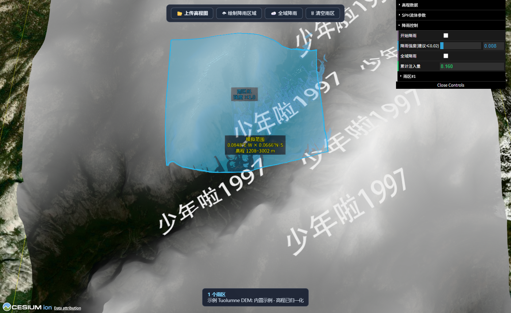

**低角度侧视：薄层沿山势汇流，洼地变深、山谷外溢**：

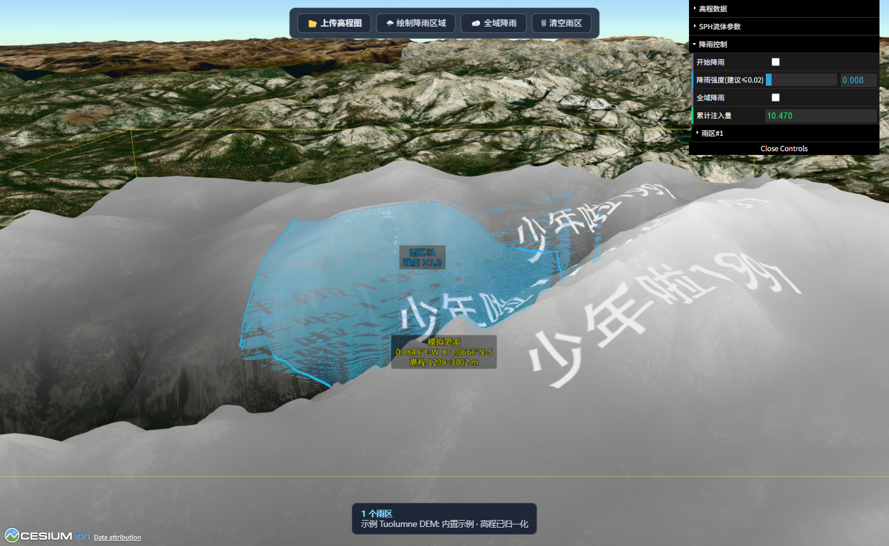

**ArcGIS 卫星影像 + 全球地形底图**：

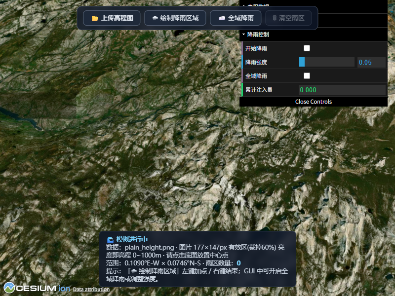

**任意多边形模拟域：水体被橙色五边形边界精确裁剪，域外无水**：

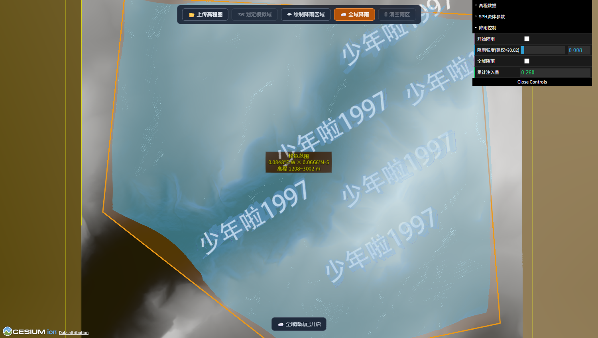

**默认全球地形模式：直接在真实卫星地形上画五边形区域，自动采样高程并模拟**：


**降雨长跑后域内积水清晰可见（蓝色水层）**：

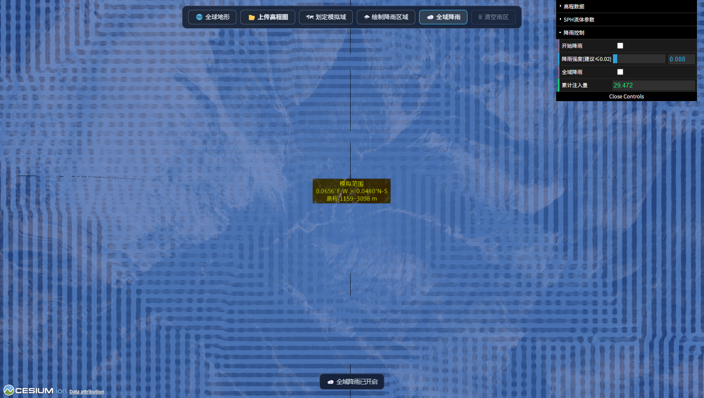

**模拟域 / 雨区面积标注（重心贴地标签 + bbox 标注三行错开）**：

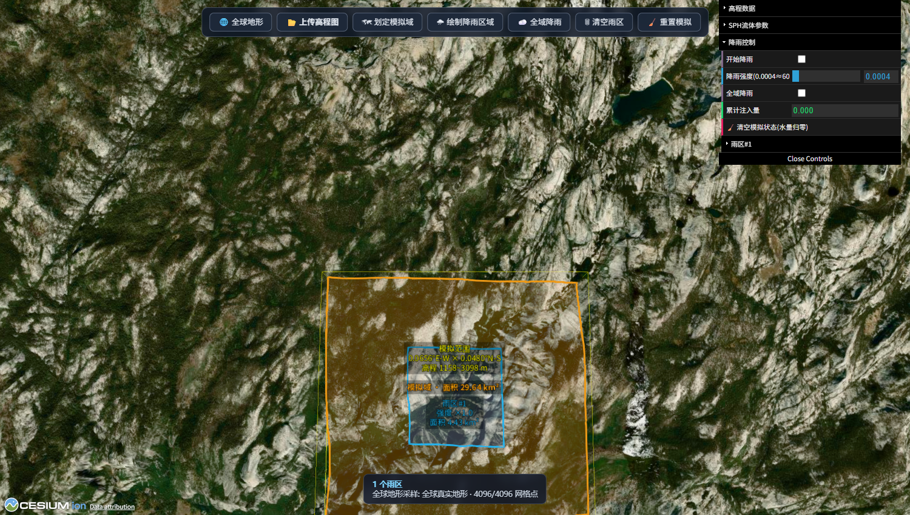

**降雨中的雨滴下落效果（三层屏幕空间雨丝，密度随雨强变化）**：

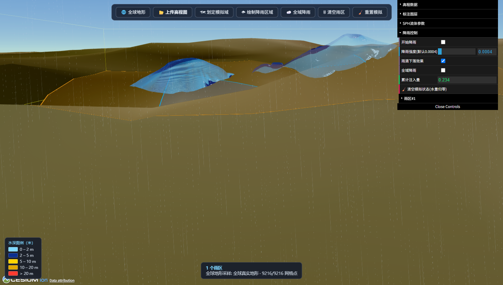

**5 档水深配色：浅蓝浅水、深蓝较深、黄/深黄深水，左下角图例实时同步；底图为卫星影像 + 路网/地名标注**：

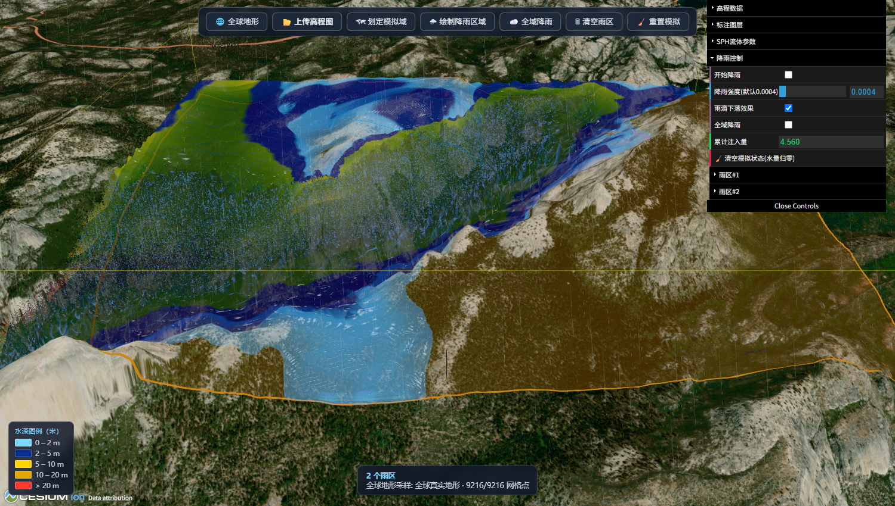

**中文路网 / 地名叠加层（高德透明瓦片，叠在卫星影像上；四川·成都平原为例）**：

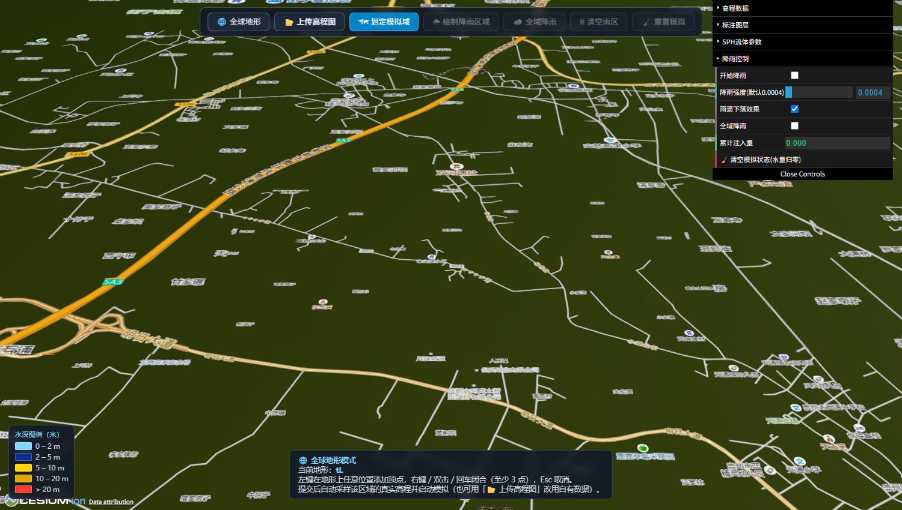

**雨量模式：一场 500mm / 60s 的降雨下完后，雨区与下游汇水（浅蓝=0–2m 真实水深）**：

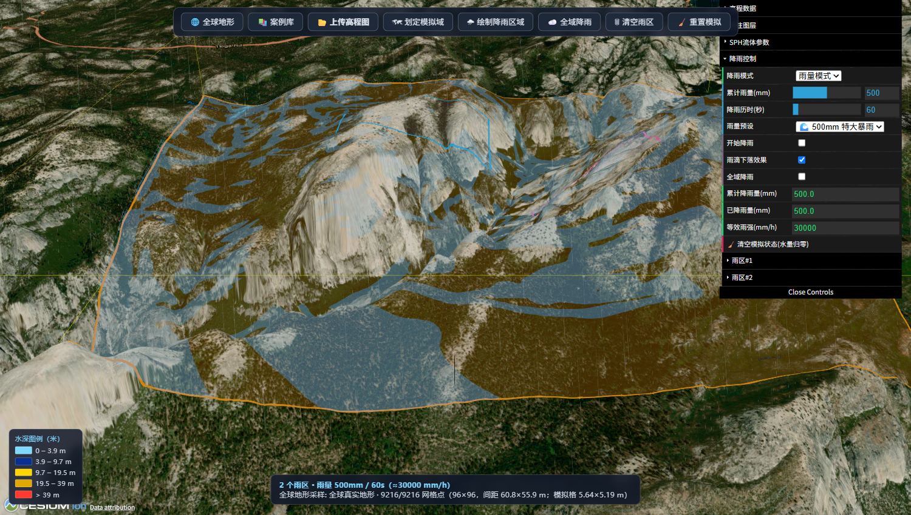

**案例复演：甘肃渭源双石门沟“7·26”山洪（50 mm 预警量级 vs 150 mm 局地强暴雨，详见 [docs/ANALYSIS_shuangshimen.md](docs/ANALYSIS_shuangshimen.md)）**：

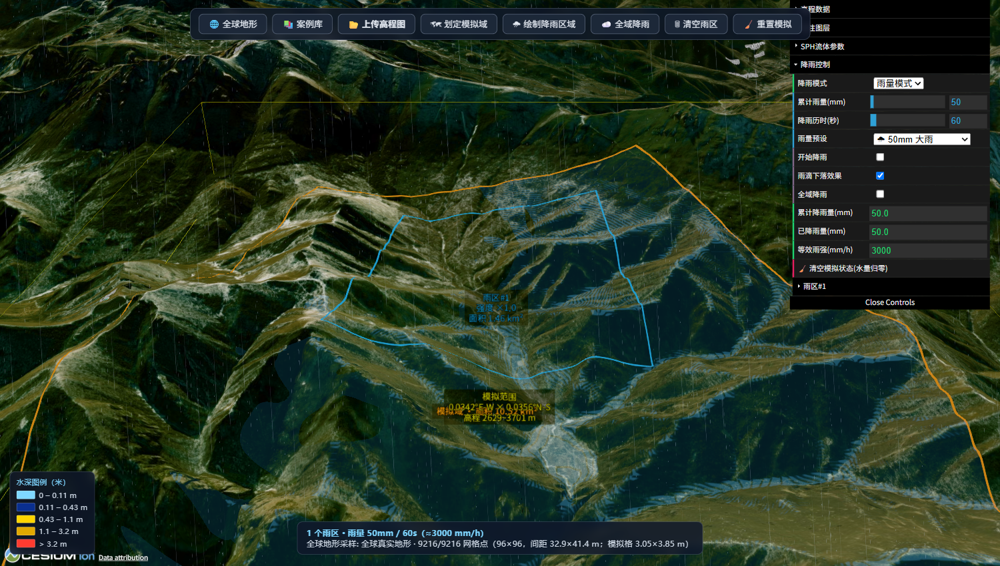

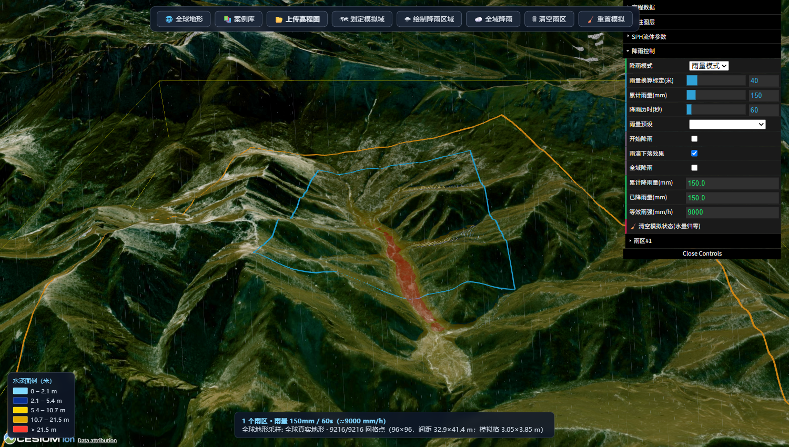

**山洪案例库：卡片式案例列表 + 事件详情，点「▶ 一键复演」自动建域/圈雨区/设雨量并开始模拟**：


## 3. 快速开始

### 运行应用

```bash
# 任意静态服务器指向仓库根目录即可
npx http-server -p 8080
# 或 python -m http.server 8080
# 浏览器打开 http://127.0.0.1:8080（需 WebGL2，Chrome/Edge 现代版本）
```

打开页面**默认就是全球地形模式**（打开即见真实卫星影像 + 3D 地形），完整操作流程：

1. **直接在地形上画模拟域**：左键在任意地表逐点添加顶点，右键 / 双击 / 回车闭合（≥3 点）。提交后系统自动采样该多边形范围内的真实高程（见 §5.7），生成域掩膜并启动模拟。无需上传任何数据。
2. **（可选）改用自有高程图**：点「📂 上传高程图」→ GeoTIFF 自动解析覆盖范围 / 普通图片按提示点击放置 → DEM 叠置到地形上，同样进入"请划定模拟域"阶段。
3. **在域内绘制雨区 / 开启降雨**：点击「🌧 绘制降雨区域」在模拟域内画多边形（顶点必须全部落在域内），GUI 勾选「开始降雨」；或直接用「全域降雨」给整个模拟域注水。**模拟域与每个雨区提交后都会在重心处显示面积标签**。
4. **重置试算**：点「🧹 重置模拟」清空水量与累计注入，保留模拟域和雨区，从 0 重新开始；点「🌐 全球地形」则回到默认模式重新划域。
5. **视觉选项**（右侧 GUI）：「标注图层」可开关道路网 / 地名标注 / 中文路网地名；「降雨控制 → 雨滴下落效果」控制屏幕雨丝；「SPH 流体参数 → 5档水深配色」只保留「启用5档着色」与 5 个颜色（分档米数随体积盒跨度自动缩放，图例实时同步）；「水透明度」拉到 0 时水体完全不可见。雨量换算标定在「降雨控制 → 雨量换算标定(米)」。
6. **按实际雨量模拟**（右侧 GUI「降雨控制」）：把「降雨模式」切到「雨量模式」→ 选「雨量预设」（如 50mm 大雨 / 100mm 暴雨 / 500mm 特大暴雨）或直接调「累计雨量(mm)」与「降雨历时(秒)」→ 勾选「开始降雨」。面板会实时显示「已降雨量(mm)」与「等效雨强(mm/h)」，**下满设定雨量后自动停止**；想看下一场雨重新勾选「开始降雨」（累计归零）或用「🧹 重置模拟」清空水量（§5.13）。

水体被严格限制在橙色模拟域边界内，域外无水。

### 运行测试（无头浏览器冒烟测试，23 项断言）

```bash
cd test
npm i                # 安装 puppeteer-core
# 需要本机 Chrome；如路径不同：
#   set CHROME_PATH=C:\path\to\chrome.exe
# 终端 1：node server.mjs     （静态服务器 :8931）
# 终端 2（可选）：手工启动 headless Chrome，见 test/smoke.mjs 头注释
npm test             # node smoke.mjs
```

测试内容：默认全球模式（无 DEM/无流体） / **全球划域→采样真实地形→启动（域掩膜+域约束）** / 域外雨区被拒绝、域内雨区成功 / 雨区→掩膜→注入累加→停止 / 全域降雨 / GeoTIFF 自动定位后划域 / UTM 投影换算后划域 / PNG 手动放置后划域 / 无致命错误。输出 `report.json` 与截图。另有 `verify_irregular_domain.mjs`（上传模式凸五边形域）、`verify_globe.mjs`（全球模式 12 项）、`verify_globe_top.mjs`（正俯视视觉）等专项脚本。

## 4. 系统架构

```
index.html ──┬── Cesium 1.132（内置）
             ├── libs/dat.gui.min.js     GUI 面板
             ├── libs/geotiff.min.js     GeoTIFF 解析（UMD 全局 GeoTIFF）
             ├── libs/proj4.js           投影坐标系转换（UMD 全局 proj4）
             └── index.js (module)       主控
                    │
   ┌────────────────┼────────────────────────────────┐
   │ 数据流（两条入口，最终都产出 dem + 多边形域）   │
   │ 【默认·全球模式】用户在真实地形上画多边形       │
   │   DomainEditor(freeMode).onChange → domain.extent(多边形bbox)
   │      → sampleTerrainDem(provider, bbox) → dem{canvas, min/max, extent}
   │      → onDomainCommitted → flyTo + addRangeOutline
   │ 【可选·上传模式】                              │
   │  File → elevationLoader → ElevationData         │
   │  {canvas 1024²灰度, min/max, extent|null, info} │
   │      │ extent 有效 → prepareDomain()（叠置+划域提示，未启动）
   │      │ extent 为空 → pendingPlaceDem → 点击底图  │
   │      │                → 采样地形高程            │
   │      ▼                                          │
   │  用户绘制任意多边形模拟域 → DomainEditor.onChange │
   │      ──▶ rasterizeDomainMask → onDomainCommitted  │
   │      ──▶ regionEditor.setDomain(域多边形)          │
   │      ──▶ startSimulation:                        │
   │    TerrainFluidSimulation(viewer, dem, options)  │
   │      ├─ 5 个 Primitive 阶段（GPU 管线）           │
   │      │   BufferA 积分/初始化 (particleTexture)    │
   │      │   BufferB 物理+注入   (simulationTexture)  │
   │      │   BufferC 平滑高度场   (surfaceTexture)    │
   │      │   History 回写         (historyTexture)    │
   │      │   Volume 光线步进渲染  (盒体 DrawCommand)  │
   │      ├─ setRainMask(canvas)   重建雨区掩膜纹理    │
   │      └─ setDomainMask(canvas) 重建域掩膜纹理      │
   │                                                  │
   │ 交互流                                            │
   │  工具栏 ── DomainEditor（先） ─▶ 域掩膜 ─▶ 模拟启动 │
   │  工具栏 ── RainRegionEditor（后） ── onChange     │
   │      ──▶ rasterizeRainMask(区域列表) ──▶ fluid    │
```

- **双入口主控流程**：
  - 全球模式（默认）：打开 → `startGlobalDomainDraw()` → 用户在地形上画多边形 → `DomainEditor(freeMode)._commit` 由多边形 bbox 反推 `domain.extent` → `onDomainCommitted(domain)`（async）→ 采样真实地形生成 dem → `addRangeOutline` + `flyTo` → `finishStart(dem, domainMaskCanvas)`。
  - 上传模式（可选）：`handleUploadFile` → `prepareDomain(dem)`（解析 + 叠置 + `domainEditor.startDrawing(dem.extent)`，**不启动模拟**）→ 用户闭合并提交多边形 → `onDomainCommitted(domain)`（复用 pendingDomainDem）→ `finishStart(...)`。
  - 二者都保证"先划模拟域、再在域内划雨区"。
- 体积盒用 dem 覆盖范围生成（全球模式=多边形 bbox，上传模式=高程图覆盖范围；保证 heightMap uv 与着色器 uv 对齐、地形不错位）；模拟域只是盒内的一个多边形，通过 1024² 域掩膜表达。
- 上游管线每帧执行 **两次物理子步**：`BufferB(simulationTexture)` 与 `simulationHistoryStage`（同一着色器再跑一遍写 historyTexture），注入发生在两处（同一掩膜、同一强度），累加语义一致。
- 每次切换数据调用 `teardownSimulation(true)`：销毁 5 个阶段、4 张模拟纹理、DEM/掩膜纹理、边界实体、叠置层，并清空雨区。

## 5. 核心技术细节

### 5.1 坐标系与方向约定（必读）

整条链路存在**四个空间**，方向约定错误会表现为"雨区与水体位置镜像/错位"。当前约定如下，**改动任何映射前先读懂本节**：

| 空间 | 定义 | 北在哪 | 换算 |
|------|------|--------|------|
| 地理 | 经纬度（Cartographic） | — | — |
| 粒子/着色器 uv | `pos / 1024`，gl_FragCoord 原点在左下 | `v = 0` | `u = lonNorm`，`v = 1 - latNorm` |
| 画布（DEM/掩膜） | 1024² 位图，flipY:false 直传 GPU，纹理第 0 行 = 画布顶部 | `y = 0`（顶部） | `x = u·S`，`y = v·S`（v 为着色器空间值） |
| 体积盒模型空间 | BoxGeometry 单位立方 ±0.5，`getHeight` 用 `p.xz+0.5` 作 uv | `v = 0`（p.z = -0.5 端） | 模型矩阵 `rotX(90°)` 使 local Y→UP、local Z→南向，因此 p.z=-0.5 恰为北端 ✓ |

推导要点（曾两次在此翻车，见 §6）：

- 原版 `centeredY = 1 - y` 的翻转发生在"经纬度 → 着色器空间"这一步；
- 掩膜画布与 DEM 编码同为 north-up 位图直传（flipY:false），着色器 v=0 采样纹理第 0 行 = 画布顶部 = 北，所以**画布 y 直接用 v，不要再取反**；
- 体积盒 `generateModelMatrix([90,0,0])` 的旋转把模型 Z 轴转到 -North，`p.z+0.5` 的 v=0 恰好对应北端——与 DEM 行序天然一致，**无需额外翻转**。

统一换算函数在 `src/sim/geoUtils.js`：`cartoToSimUV` / `cartoToCanvasPx` / `rectangleAroundCenter`。

### 5.2 高程图加载与覆盖范围解析

`src/io/elevationLoader.js`，入口 `loadElevationFile(file)`，输出统一结构：

```js
{ kind, sourceName, canvas /*1024²灰度,R通道=归一化高程*/,
  minElevation, maxElevation,
  extent /*[minLon,minLat,maxLon,maxLat]|null*/,
  contentAspect, info }
```

- **GeoTIFF 分支**：`GeoTIFF.fromArrayBuffer` → `image.getBoundingBox()` 得 bbox → `resolveGeoReference()` 解析地理参考（见下）；`readRasters({samples:[0],width:1024,height:1024,resampleMethod:"bilinear"})` 重采样；`getGDALNoData()` 剔除无效像元后统计 min/max；行序保持原栅格（北在上）直接编码画布。
- **地理参考解析**（`src/io/projection.js`，`resolveGeoReference(fileDir, bbox)`）：区分两种坐标系——
  - **地理坐标系**（`GTModelType=2`，或 bbox 落在经纬度合法区间）：bbox 直接作为 extent，单位显示为 `°/px`；
  - **投影坐标系**（`GTModelType=1`）：先看 `ProjectedCSType` GeoKey 的 EPSG 编码是否被 proj4 内置（WGS84 UTM 326xx/327xx、3857 等）；不内置（如 CGCS2000 的 EPSG:4490/4547）则按 `ProjCoordTrans` + `ProjNatOriginLong/Lat`、`ProjFalseEasting/Northing`、`ProjScaleAtNatOrigin`、`ProjStdParallel1/2` 现场拼 `+proj=…` 定义串，椭球按 `GeographicType` 映射（4490/4258/4269→GRS80、4267→clrk66、其余→WGS84）。换算用 **7×7 网格采样**取经纬度外包，而非只取四角——横轴墨卡托下经度沿东西向非线性，只取角点会失真。
  - **兼容性坑**：geotiff.js 各版本 `fileDirectory` 表示不同——旧版是数组且 tag 名带 `Tag` 后缀（`ModelPixelScaleTag`），新版返回普通对象（键为 `"0","1",…`）且名无后缀（`ModelPixelScale`）。`asIndexed()` / `tagArray()` 两种都归一化，否则 GeoKey 全部解析为空、投影图纸被误判"未知投影"。
  - 换算失败或无地理参考时 `extent=null`，走手动放置并给出具体原因（`geoRef.note`）。
- **普通图片分支**：`createImageBitmap` → 缩到 ≤2048 分析 → `detectContentBounds()` 识别纯色边框/透明边并裁剪（边缘环取主色调，占比 >40% 才认定为边框；裁剪面积 <4% 或 >99.5% 放弃裁剪防误判）→ 亮度转灰度 → 默认高程 0~1000m。
- **手动放置 + 贴地**：`index.js#placePendingDemAtDegrees` 点击中心后，`rectangleAroundCenter` 按放置宽度算 bbox（经度除 cos(纬度)），再 `sampleTerrainMostDetailed` 采样四角+中心真实高程，`min/max = 地面 -0.1/×0.9 × reliefMeters`，保证盒子浮在真实地表上而非埋入地下。

### 5.3 模拟域（任意多边形）与域掩膜

**为什么需要它**：原版水体只能装在"高程图覆盖范围"这个矩形盒里，用户无法指定不规则的计算边界。改为先在高程图范围内画任意多边形作为模拟域，水体被严格限制在域内。

**交互编辑器** `src/ui/domainEditor.js`：工具栏「🗺 划定模拟域」按钮激活后，左键在高程图覆盖范围内逐点添加顶点（点前会校验 `_withinExtent`），右键 / 双击 / 回车闭合（≥3 点），Esc 取消。橙色 `#f59e0b` 贴地多边形 + 顶点标记可视化。提交结果 `domain = { simPoly, cartos, label }`，`simPoly` 是着色器空间 uv 顶点数组。

**栅格化** `src/sim/domainMask.js`：`rasterizeDomainMask(simPoly)` 把多边形填成 1024² 黑白画布（黑底 + 白域），坐标 `y = v·S` 与高程图/雨掩膜同 north-up 约定（§5.1）；`pointInPolygon(u, v, poly)` 射线法供雨区顶点校验。

**三重约束**（`src/sim/shaders.js` + `rainRegionEditor`）：

1. **物理层**：`Simulation()` 末尾，若 `domainEnabled > 0.5`，采样 `domainMask`：域外格子质量按 `mix(0.85, 0.0, step(dom,0.1))` 衰减（越界越狠），并用 `domainNormal()`（掩膜梯度，指向域内）反射速度，`vn<0` 的入射分量被抵消 —— 水撞到域边界会被弹回而非漏出。
2. **降雨注入**：`P.M.x += rainIntensity × dt × texture(rainMask,suv).r × texture(domainMask,suv).r` —— 全域降雨也不会往域外注水。
3. **渲染层**：`surfaceSmoothingSource` 输出水密度乘 `domainAt(pos)`（域外为 0），域外绝对不渲染水面；地形高度不受影响。

`fluid.setDomainMask(canvas, enabled)` 管理域掩膜纹理（未启用时回退 1×1 全白纹理，等效无约束）。域多边形切换数据时随 `teardownSimulation(true)` 一并清理。

> 调试教训（§6.4）：`_renderDomain()` 曾误调 `clearDomain(false)` 把刚设置的 `this.domain` 清空，导致 onChange 收到 null、模拟始终不启动；重写为只移除实体。另 `_commit()` 里 `_status()` 必须放在 `_notifyChanged()` **之前**，否则主控在 finishStart 设置的"模拟进行中"会被"模拟域已划定"覆盖。

### 5.4 降雨区域与掩膜管线

```
编辑器多边形(着色器空间uv) ──rasterizeRainMask──▶ 1024² 画布
   区域填充灰度 = clamp(intensity,0,1)×255
   合成模式 lighten（逐通道取 max → 重叠区取最大强度）
   全域降雨 = 先铺满白再叠区域
        │ toDataURL 不需要——画布直接作 Cesium.Texture source
        ▼
fluid.setRainMask(canvas) ──▶ RGBA UNSIGNED_BYTE 纹理（LINEAR/CLAMP）
        ▼
着色器 Simulation()：P.M.x += rainIntensity × dt × texture(rainMask, uv).r
```

- 区域增删/启停/改强度 → `editor.onChange` → `applyRainRegions()` 重建画布 → `setRainMask` 销毁旧纹理重建新纹理（低频操作，开销可接受）。
- 无任何雨区且未开全域时传 `null`，uniform 回退到 1×1 黑纹理，`rainIntensity` 归零，零开销。
- 编辑器实体：填充多边形（不指定 height → Cesium 自动 GroundPrimitive 贴地）、`clampToGround` 边界线、贴地标注（强度实时刷新）。

### 5.5 SPH 着色器改动

`src/sim/shaders.js`（从 index.js 抽出，便于复用与审阅）：

1. **新增 uniform**：`rainIntensity`（全局强度，开关关闭时 CPU 侧传 0）、`rainMask`（采样器）、`domainMask`（域掩膜采样器）、`domainEnabled`（域约束开关，0/1）。辅助函数 `domainAt(pos)`（取域内程度）、`domainNormal(pos)`（掩膜梯度法向，指向域内）。所有掩膜采样统一走 `texelC()` 宏（`texelFetch` + clamp 整数像素），规避 `texture()` 在非均匀控制流下的隐式导数问题。**ANGLE/D3D11 兼容红线（§6.6）**：这两个含 `texelFetch` 的函数内绝不能写条件 `early return`，也不能把 `step(uniform)` 乘进采样结果；未启用域时 CPU 侧绑定全白纹理，`domainAt` 天然返回 1.0、梯度天然为 0，因此无需任何运行时判断。
2. **注入点**：`Simulation()` 在原"点源注水"后新增掩膜注入（BufferB 与 History 两个阶段共用，与上游双子步设计一致），注入量再乘 `domainMask` 保证域外不注水；`Simulation()` 末尾追加域边界约束（§5.3 物理层）。
3. **全覆盖幽灵初始化**（BufferA）：原版 60% 格子初始化粒子、40% 空格 → 降雨只落在 60% 格子、附着斑驳。改为**每格都初始化 1e-6 幽灵质量**（`max(initialMass, 1e-6)`），雨水可附着于任意地表格，逐渐积蓄成可见薄层。幽灵质量对压力项贡献可忽略，不改变无雨区外观。
4. **heightScale = 0.25（高程对齐，见 §6.3）**：`getHeight` 的 `terrainH = data.y × heightScale - 0.5`，而 `terrainHeight = DEM归一化 × 4.0`，故 `4.0 × 0.25 = 1` → 盒内地形精确铺满体积盒的 `[minElevation, maxElevation]` 绝对高程区间，与真实地形重合，水面才会"贴"在看得见的地表上。**改 DEM 编码倍率或 heightScale 时必须保持该乘积为 1。**

### 5.6 基础地形与底图

`index.js#initViewer` 加载链：

| 层 | 有 Token | 无 Token（默认） | 失败降级 |
|----|----------|------------------|----------|
| 地形 | `CesiumTerrainProvider.fromIonAssetId(1)` | `ArcGISTiledElevationTerrainProvider.fromUrl(elevation3d.arcgis.com/.../Terrain3D/ImageServer)` | 椭球面（不影响模拟） |
| 底图 | Viewer 默认 Ion 影像 | `ArcGisMapServerImageryProvider.fromUrl(server.arcgisonline.com/.../World_Imagery)` | OSM → 无底图 |

实测本机网络：`server.arcgisonline.com` 与 `elevation3d.arcgis.com` 可达，`tile.openstreetmap.org` 不通，故 ArcGIS 优先。两个域名常量在 `BASEMAP_SOURCES`。

贴地渲染：雨区实体/范围框/标注全部 `CLAMP_TO_GROUND` 或 GroundPrimitive；模拟范围框 `heightReference: RELATIVE_TO_GROUND, height: 150`。

### 5.7 全球地形直接划域（地形采样）

默认模式。用户不上传任何数据，直接在全球卫星地形上画多边形，`src/io/terrainSampler.js` 负责把该区域真实高程转成 SPH 需要的 1024² 灰度高度图：

1. **范围来源**：多边形提交时（freeMode）由顶点经纬度 bbox 反推 `domain.extent`（十进制度），同时作为体积盒范围（与上传模式的 dem.extent 等价）。
2. **采样策略（性能关键）**：在 bbox 内铺 `globeSampleGrid × globeSampleGrid`（默认 96²，GUI 预设 96²~512²，见 §5.16）个 `Cartographic` 网格点（v=0 为北，与全链路 north-up 约定一致）。
   - 优先用 `Cesium.sampleTerrain(provider, level, positions)` 固定级别采样，级别由区域跨度自适应：`ideal = log2(360 / spanDeg) + 1.3`，clamp 到 8~15。
   - 失败才退化到 `sampleTerrainMostDetailed`。
   - **实测性能差约 70×**：固定级别 12 采样 32×32 点耗时 ~147ms，而 `sampleTerrainMostDetailed` 同样点数需 ~10231ms。这正是不能图省事直接用 mostDetailed 的原因（会卡界面 10 秒以上）。
3. **高程归一化**：`Float64Array` 存采样高程，NaN 用最近有效值填充；统计 min/max 后上下各留 5% 余量（跨度 <1m 时给 ±5m）；`encodeHeightGrid()` 双线性插值放大到 1024² 灰度画布，`g = (h - min) × 255 / (max - min)`（行 0 = 北），喂给着色器 heightMap。
4. **模拟框相机**：采样完成后 `flyTo` 到 bbox（留 0.4× 边距、pitch -55°、1.5s），便于观察贴地汇流。
5. **降级**：无可用地形 provider 或采样全部失败时构造平坦 DEM（`flat=true`），模拟仍可运行，只是高度场为常数。

验证：`test/verify_globe.mjs`（12 项）覆盖默认模式、五边形采样启动、重复划域、注入等，ALL PASS；`sampleTerrain` 优化后全球划域启动耗时从 ~36.7s 降到 ~2.3s。视觉截图 `docs/images/06_globe_domain.png` 显示水体随真实山地起伏汇聚、域外无水。

### 5.8 区域面积标注与「重置模拟」

**面积计算（`src/sim/geoUtils.js`）**：`polygonAreaKm2(points)` 用球面多边形面积公式，对每条边沿纬向积分：

```
A = R² / 2 · | Σ (λ₂ − λ₁)(sin φ₁ + sin φ₂) |      R = 6371008.8 m
```

- 顶点顺序顺/逆时针均可（结果取绝对值），对几十公里尺度的区域精度优于 1%；`< 3` 点或非法输入返回 0。
- 入参同时支持 `Cesium.Cartographic`（弧度）与 `{lon, lat}`（度），由 `pointToRadians()` 统一换算。
- `areaLabel(km²)` 按量级切换文案：`< 0.01` → `X m²`；`< 1` → `0.123 km²（123 456 m²）`；`< 100` → `xx.xx km²`；`< 10000` → `xxxx.x km²`；更大用千分位。
- 数值校验：0.01°×0.01° 方块 @34.5°N 算得 1.0189 km²（理论 ~1.019 km²），见 `test/probe_area_math.mjs`。

**标注位置**：模拟域与每个雨区提交后在多边形**重心**处生成一个贴地 label 实体（`heightReference: CLAMP_TO_GROUND` + `disableDepthTestDistance: ∞`），文本随参数实时刷新：

| 标签 | 文本 | 竖直偏移 |
|------|------|----------|
| 模拟范围（bbox） | `模拟范围 / 0.0656°E-W × 0.0480°N-S / 高程 1159~3098 m` | -64 px |
| 模拟域 | `模拟域 · 面积 29.64 km²` | -20 px |
| 雨区 | `雨区#1 / 强度 ×1.0 / 面积 4.43 km²` | +26 px |

三个标签都在重心附近，**偏移必须错开**，否则会互相遮挡（最初三者都用 -14~-18 px，实测只看得见最上层那个）。状态栏同时汇总「模拟域面积 / 雨区数量（合计面积）」，GUI 每个雨区子面板也带独立面积。

**「🧹 重置模拟」（`restartSimulation()`）**：工具栏按钮与 GUI 降雨控制面板内的 `🧹 清空模拟状态(水量归零)` 是同一入口。

- 保留：模拟域、雨区、相机视角、当前 DEM（`state.currentDem`）与域掩膜画布（`state.domainMaskCanvas`）。
- 重置：`fluid.destroy()` 后重建 `TerrainFluidSimulation` → 粒子质量/水量、累计注入量、帧计数（`_frame`）全部归零；随后 `setDomainMask()` + `applyRainRegions()` 恢复域掩膜与降雨掩膜，降雨开关状态不变。
- 相比「🌐 全球地形」（要重新采样地形 + 重新划域）或重新上传，可以**一键反复试算同一场景**。
- 关键点：`finishStart()` 必须把 `dem` 与 `domainMaskCanvas` 存进 `state`，否则重置时拿不到原始高程数据只能重新采样。

验证：`test/verify_area_reset.mjs`（17 项）覆盖面积数值合理性（多边形面积 < bbox 面积且同量级）、三个标签文本、工具栏按钮可用、重置后注入量归零且可重新累计、域与雨区保留、无致命错误，ALL PASS。截图 `docs/images/11_area_labels.png`。

### 5.9 公共资源标注（道路网 / 路名 / 地名）

在底图影像之上叠加两层 ArcGIS Reference 透明瓦片（`BASEMAP_SOURCES.arcgisTransport` / `arcgisPlaces`）：

- `Reference/World_Transportation`：公路、路名、公路编号盾牌；实测瓦片不透明像素仅约 4.9%，可直接叠在卫星影像上。
- `Reference/World_Boundaries_and_Places`：城市/村镇/山峰/河流名与行政边界；不透明像素约 2.8%。
- 不能用 `World_Street_Map`（不透明像素 100%，会完全盖住卫星影像）。
- `addReferenceLayers()` 并行 `ArcGisMapServerImageryProvider.fromUrl()` 加载两层，**每层最多等 6 秒**：网络抖动时不能阻塞场景就绪（最初 await 无上限，曾导致页面 90 秒未就绪）；超时后请求继续在后台跑，返回后仍会把图层补进影像栈。加载失败只 `console.warn`，不影响模拟。
- GUI「标注图层」folder 两个勾选（`options.refRoads` / `options.refPlaces`，默认开）→ `syncRefLayers()` 同步 `layer.show`。页面加载后影像层总数 = 底图 1 + 参考层 2 = 3。

**中文标注（中国境内）**：上面两层是英文注记，另外提供两种中文叠加源：

| 源 | 地址 | 是否需要 tk | 坐标系 | 说明 |
|----|------|------------|--------|------|
| 高德「路网+注记」 | `webst0{s}.is.autonavi.com/appmaptile?style=8&lang=zh_cn&size=1&scl=1` | 免 tk | GCJ-02（火星坐标） | 实测瓦片透明背景（不透明像素约 8.1%），可直接叠在卫星影像上；中文村镇名、道路线、高速编号齐全；**中国境外无瓦片**，与 WGS84 影像有数百米偏移，仅作视觉参考 |
| 天地图「中文注记」WMTS `cva_w` | `t{s}.tianditu.gov.cn/cva_w/wmts?...&tk={tk}` | 需自备 tk | CGCS2000≈WGS84 | 与影像无偏移，官方服务稳定；tk 在 `console.tianditu.gov.cn` 免费申请，填入 GUI「天地图tk」后自动加层 |

- 高德层用 `UrlTemplateImageryProvider`（`subdomains: ["1","2","3","4"]`，`maximumLevel: 18`）在初始化末尾同步创建（不需要 await，不阻塞场景就绪），默认 `options.refZhAmap = true`；关闭时只 `layer.show = false`，不销毁图层。
- 天地图层由 `ensureTdtZhLayer()` 惰性创建，`options.tdtToken` 变化时**重建**图层（旧层 `imageryLayers.remove(layer, true)`）；tk 为空时勾选会提示"需要 tk"，不会创建空图层。
- GUI「标注图层」新增「中文路网/地名(高德)」「中文注记(天地图·需tk)」「天地图tk」三项 → `syncZhLayers()`。测试钩子 `__app.refLayers().zh` 返回 `{amap, amapCreated, tdt, tdtCreated, tdtTokenApplied}`。

### 5.10 雨滴下落效果（屏幕空间后处理）

`src/render/rainEffect.js` 用 `Cesium.PostProcessStage` 做全屏雨丝，不碰模拟管线：

- `uniforms` 全部用函数实时取值：`u_time = performance.now()*0.001`、`u_amount = clamp(rainFxAmount(), 0, 1.5)`。
- 着色器 3 层叠加 `rainLayer(uv, columns, speed, tailLen, thickness)`：列 hash 相位 + `y = uv.y*3.4 + u_time*speed` 向下移动 + `smoothstep` 生成雨丝头尾；56/96/148 列、权重 0.50/0.70/0.90，`uv.x` 做视口宽高比修正，`uv.x += uv.y*0.06` 产生 3° 风斜；`mix(scene.rgb, rainTint(0.84,0.90,1.0), drops*0.58)`，并整体压暗 `col *= mix(1.0, 0.87, u_amount)`。
- **必须无分支**：避免 `if` / `early return` / `step(uniform)`——§6.6 已证明 ANGLE/D3D11 会因此生成非法 HLSL，真机 GPU 直接编译失败。
- 开关：每帧 `updateRainEffect()` 仅在 `options.rainEnabled && options.rainFx && (全域降雨 || 启用雨区数 > 0)` 时 `setEnabled(true)`；`rainFxAmount()` 把雨强按 `rainIntensity / 0.0004` 映射到 0.35~1.25（雨强越大雨丝越密），未降雨/无雨区返回 0。
- GUI「降雨控制」→「雨滴下落效果」勾选（`options.rainFx`，默认开）。

### 5.11 5 档水深配色

`fluidVolumeFragmentSource` 增加 `depthRamp(depthM)`：用 smoothstep 链在 5 档色之间过渡（同样全程无分支），原「浅水→深水」渐变作为 0 档兜底：

| 档位 | 水深（按体积盒跨度 0.2%/0.5%/1%/2%） | 跨度 1000 m 时 | 默认颜色 |
|------|------|------|----------|
| 0 | 0 – 0.2% 盒高 | 0 – 2 m | 浅蓝 `#7fd8ff` |
| 1 | 0.2% – 0.5% | 2 – 5 m | 深蓝 `#0a2f8f` |
| 2 | 0.5% – 1% | 5 – 10 m | 黄 `#ffd400` |
| 3 | 1% – 2% | 10 – 20 m | 深黄 `#e0a800` |
| 4 | > 2% | > 20 m | 红 `#ff3b30` |

- **分档必须与水体几何高度用同一把尺子**：着色器里 `waterDepth` 是「占体积盒高度的归一化比例」，水面几何高度就是 `waterDepth × 体积盒高程跨度`。早期版本用固定米数 2/5/10/20 m 着色、却按 `depthFullM=40` 换算，山区 1000 m 级体积盒里水明明堆了几十米高、图例却只显示一两米——用户一眼就看出"水很深、颜色很浅"。现在 `DEPTH_BAND_FRACS = [0.002, 0.005, 0.01, 0.02]` 乘以**当前体积盒真实跨度**得到分界（`currentDepthBands()` / `currentBoxThicknessM()`），`depthRangeM` uniform 同样等于盒跨度，于是颜色、图例、几何高度三者完全一致。
- 选 0.2%/0.5%/1%/2% 的原因：在常见的 1000 m 级山区体积盒上正好落回 2/5/10/20 m 这套直观米制刻度；换成起伏 235 m 的夹具流域则自动缩到 0.5/1.2/2.4/4.7 m，不会因为盒子矮就全部变红。
- 因而**不再提供可拖动的分界滑块**（曾经能拖出 23.5–23.5 这类退化档位）与 `depthFullM` 配色滑块；`depthFullM` 只保留为雨量换算标定（§5.13），放在「降雨控制」里。
- 颜色 uniform 传 sRGB 原值，着色器内 `czm_gammaCorrect()` 转线性后再混合；`depthColorEnabled` 为 0/1 uniform（默认 1），关闭则回退原渐变。
- 左下角 `#depthLegend` 图例由 `updateDepthLegend()` 依据 `currentDepthBands()` 实时重建；流体建立后（`finishStart()`/`restartSimulation()`）与打开分档着色时都会刷新，所以图例米数会随盒跨度变化。
- 透明度语义（GUI「水透明度」）：滑块 **0 = 完全不透明（alpha = 1.0）**、**1 = 最透明（alpha = 0.2）**，中间线性插值：着色器里 `float waterOpacity = mix(1.0, 0.2, clamp(waterAlpha, 0.0, 1.0));`，水体 alpha 与 Fresnel/高光都乘它，避免"不透明档反而漏光"或"最透明档还留一层亮膜"。默认 0.2 对应 alpha≈0.84，与早期固定值观感一致。

验证：`test/verify_features2.mjs`（29 项）覆盖参考图层、图例 5 行动态文案与色块、`depthColorEnabled` → uniform 与图例联动、`depthRangeM = 盒跨度`、雨滴渲染证据；`test/verify_fixes4.mjs`（21 项）覆盖分档随盒跨度缩放、累计降雨量跨场累加、水透明度=0 时水体像素差分 0.58%（≈完全不可见）。截图 `docs/images/12_rain_effect.png`、`docs/images/13_depth_colors.png`。

### 5.12 相机进入体积盒后的水体可见性（贴地也能看到水）

体积渲染是整个模拟里最容易"贴着地面就什么都看不见"的地方，原因是几何而不是物理：

- 体积盒 = 域宽 × 域高 × `_volumeThickness`（= 域内 `maxElevation − minElevation`），竖直中心为 `_volumeCenterElevation`。盒顶通常比最高峰还高、盒底比最低谷还低，**相机只要降入盒顶以下就进入了盒内**（山区动辄一两千米的盒高，贴地视角几乎必然在盒内）。
- `FluidVolumeStage` 原来用 `cull: { enabled: true, face: Cesium.CullFace.BACK }` 只画朝向相机的面。相机在盒外时没问题；**一旦进入盒内，盒子的所有面都背对相机 → 全部被剔除 → 水体整片消失**（`gl.readPixels` 对比体积阶段开/关像素差 = 0，而 `surfaceTexture` 里水是实实在在存在的）。
- 修复分两处（代码在 `src/render/FluidPipelineStages.js` 与 `src/sim/shaders.js`）：
  1. 新增 `volumeInsideRenderState = { cull: {enabled:false}, depthTest: {enabled:false}, depthMask:false, blending: <同 volumeRenderState> }`；`FluidVolumeStage` 预存 `_inverseModelMatrix` 与盒外/盒内两套 `RenderState`，`update()` 里每帧用 `Cesium.Matrix4.multiplyByPoint(_inverseModelMatrix, camera.positionWC)` 把相机变换到单位盒局部坐标，`|x|,|y|,|z| < 0.52` 即判定在盒内（单位盒是 [-0.5,0.5]³，0.52 留一点余量），据此切换 `command.renderState`。**盒内必须关深度测试**：否则盒子远侧面片的深度必然大于地形，会把其实位于水面前方的水体判掉。
  2. 关闭深度测试后，遮挡完全由片元着色器负责：水面沿射线步进后的可见条件由 `if (wt < ret.y)` 改为 **`if (wt < min(tt, ret.y))`**（`tt`=地形命中距离，`ret.y`=盒子出射距离），保证"水在地形之前"才绘制，避免把山后的水画到山前。
- 单位盒的坐标轴约定：**local.y 是竖直（高程）轴**，盒顶 = local.y 0.5，水平方向是 local.x / local.z——写相机判定或调试打印时最容易搞混，别把 y 当水平轴。
- 实测（真 GPU :9223，夹具 DEM 盒厚 235 m、盒顶 235 m）：修复前盒内机位体积贡献像素 = 0；修复后 h=235/210/180/140（盒内）体积阶段开/关像素差 ≈ 100%，`_insideBox` 在 h=235 处准确翻转；盒内全屏光线步进帧率约 60 fps。`h ≤ 100` 时差异降到 ~3%，是因为相机已钻进 DEM 地形内部、水体被地形挡住，属正常。
- 验证：`test/verify_features3.mjs` 断言盒外 `_insideBox=false` 且像素差 >1%，盒内（中部/近地面）`_insideBox=true` 且像素差 >1%（修复前 ≈0）。

### 5.13 按实际降雨量模拟（1mm ~ 1000mm）

除了原来的「雨强模式」（按连续雨强注水，雨不停水不停），新增**雨量模式**：给定「本场累计降雨量(mm) + 降雨历时(秒)」，按体积守恒把这场雨均匀注入雨区，下完自动停止。

- **GUI**：「降雨控制」→「降雨模式」在强度/雨量之间切换；雨量模式显示「累计雨量(mm)」「降雨历时(秒)」「雨量预设」，隐藏雨强；右侧读数变为「已降雨量(mm)」与「等效雨强(mm/h)」。预设档位 1 / 10 / 25 / 50 / 100 / 250 / 500 / 1000 mm（参考 GB/T 28592 的 24h 降水量等级），等效雨强 = `mm / 历时 × 3600`，雨丝密度按其对数映射到 0.35~1.25。
- **米制换算（体积守恒，核心）**：着色器里水量是"占体积盒高度的归一化比例"，图例米数 = `data.x × 0.25 × depthFullM`。要让「图例水深 × 面积 = 真实降雨体积」，每格目标质量必须是

  `data.x = P米 / (0.25 × depthFullM) = P毫米 / (250 × depthFullM)`

  即 `massPerMm = 1 / (250 × depthFullM)`（默认 `depthFullM=40` → `1e-4`）。于是 **1000mm 降雨 = 图例水深 1m**，与真实降雨深度一致；500mm = 0.5m。代码 `rainMassPerMm()`，注释里保留了这段推导。
- **注入节流**：`TerrainFluidSimulation._updateRainInjection()` 每帧用「剩余质量 / 剩余历时 × 真实 dt」分摊到两个 Simulation pass（各一半），`dt` 夹 0.25s 上限；达到设定雨量后 `_rainPassInjection = 0` 自动停止。因为按真实时间而不是帧数积分，**掉帧时总注入量依然守恒**。实测：100mm/10s 一场雨在 10.02s 时已注入 100.000mm、passInjection=0。
- **几何放大说明**：着色器里水柱的几何高度按体积盒高程跨度放大（倍数 ≈ 盒高跨度 / `depthFullM` ≈ 50×），保证在上千米高差的地形上米级积水肉眼可见；**5 档配色与图例现在跟随几何高度（§5.11），所以颜色与画面里看到的水深一致**；「已降雨量(mm) / 累计降雨量(mm)」才是真实雨量口径，两套口径不要混用。
- **状态与重置**：`rainProgress = { injected, total, mm, rate }`。`injected` 是内部质量统计；GUI「累计降雨量(mm)」读 `total`（`_rainTotalMm`），**跨多场降雨累加**——比如先下一场 100mm、再下一场 200mm，读数就是 300mm，只有「🧹 重置模拟」才归零；「已降雨量(mm)」读 `mm`，是**本场**进度，切换模式/雨量/历时、重开降雨、改动雨区或全域降雨时由 `resetRainfallEvent()` 归零（已注入的水量不撤销，仍会继续流动汇聚）。测试钩子：`__app.setRainfall(mm, durationSec, mode)`、`__app.rainfallConfig()`（`stats.totalMm`）。
- **实测（真 GPU :9223，夹具 DEM 盒厚 235m）**：100mm/10s 下完回读 `surfaceTexture`（雨量口径换算 `data.x×0.25×depthFullM`），湿格 63.8%、最大等效水深 0.57m；1000mm/10s 最大 1.95m；**两者水体总质量比 10.36 ≈ 10**，证明"设定雨量 → 注入量 → 落地水量"三者一致。真地形两雨区 500mm/60s 演示（显示口径，盒跨度 ~1949 m）：湿格 15%、平均 9.0 m、最大 85.3 m，5 档占比 50/26/10/8/5%，深水区出现黄/红档——"看起来深就显示深色"。
- **限制**：雨区内为**均匀面雨**，没有空间梯度；不含蒸发/下渗/出流边界；GUI 历时范围 10~600s，所以 1mm 这种小雨在一场雨里几乎不可见（真实亦如此，想看明显积水请用 100~1000mm 或切回强度模式长跑）。
- **GUI 按模式显隐的坑（dat.GUI）**：`controller.domElement` 是控件容器 `div.c`（滑块/下拉本体），不是占一行的 `li.cr`。只把 `domElement.style.display` 设为 none 会**留下空行**（标签还在、行高不变），必须 `domElement.closest("li.cr")` 整行隐藏；验证时也不能只看 `domElement`，要用整行的 `getComputedStyle` 或「面板高度变化」（实测强度模式 222px / 雨量模式 361px）。
- 验证：`test/verify_rainfall.mjs`（35 项）覆盖配置换算、注入推进与自动停止、回读水量量级、100mm vs 1000mm 质量比 ≈10、重置归零、切回强度模式、GUI 整行显隐与面板高度变化、5 档图例与无致命错误，ALL PASS。演示图 `docs/images/15_rain_amount.png`（出图脚本 `test/demo_rain_amount.mjs`）。

### 5.14 案例复演：甘肃渭源双石门沟“7·26”山洪

用全球真实地形 + 雨量模式做机制性复演，验证「上游广域汇水 + 下游狭口束水」地形在不同雨量下的响应差异。完整报告见 **[docs/ANALYSIS_shuangshimen.md](docs/ANALYSIS_shuangshimen.md)**。

- **灾点定位**：会川镇（104.01279°E, 35.03096°N）以南 10 km；实机探针在 `103.995°E, 34.945°N` 一带看到「黄香沟」注记 + G212 + 白色辫状河床 + V 型谷，确认可复演沟段，地面高程 2986~3279 m。
- **模型设置**：`test/demo_shuangshimen.mjs`，`EXTENT=[103.978,34.923,104.016,34.963]`（3.5×4.4 km，10.52 km²，高程 2629~3701 m），域多边形 6 顶点（`commitGlobeDomain(extent, vertices)`，v=0 为北），上游雨区 1.46 km²（域内约 14%），雨量模式 50 mm / 60 s 与 150 mm / 60 s（时间压缩后的等效雨强 3000 / 9000 mm/h）。
- **结果对比**（回读 `surfaceTexture`，显示水深 = 几何高度口径，盒跨度 1073 m）：

  | 情景 | 湿面占比 | 平均显示水深 | 最大显示水深 | 形态 |
  | --- | --- | --- | --- | --- |
  | 50 mm | 4.8% | 3.1 m | 17.0 m | 仅树枝状沟道内汇流，未漫滩（5 档以浅蓝/深蓝为主） |
  | 150 mm | 9.0% | 5.5 m | 31.3 m | 沟道漫溢 + 坡脚片流 + 沟口淹没扇（出现 5.4% 红色深水格） |

  雨量增至约 3 倍时湿面 1.9×、最大显示水深 1.8×，且**形态发生质变**（线状沟道 → 面状淹没），正对应露营地所在的河漫滩被整体淹没。
- **脚本要点**：①雨区顶点必须严格在模拟域内，否则 `RainRegionEditor` 整块拒绝、`_rainMaskLive` 为 null，雨量模式判定无雨区而不注水（首跑即踩此坑，雨区内缩后才通）；②出图前遍历 `viewer.entities` 把 `e.polygon.show`/`e.label.show` 置 false，去掉半透明填充蒙版与标签，只留描边与图例；③页面被遮挡时 rAF 暂停导致仿真时间落后于墙钟，**必须轮询 `rainfallConfig().stats` 直到 `passInjection===0`** 再截图，不能用固定 `sleep`。
- 图：`docs/images/16_shuangshimen_50mm.png`、`docs/images/17_shuangshimen_150mm.png`。

### 5.15 山洪案例库（点击案例 → 一键复演）

把单次复演脚本沉淀为**案例库**，让用户在界面里直接复现多个历史山洪事件，而不用改代码或记住坐标。

- **数据**：`src/data/cases.js` 导出 `CASES`（4 条）与 `getCase(id)`。每条案例 = `id / site / name / date / severity / loss / scenario / summary / mechanism / sources / extent / domainUv / rainUv / mm / dur / camera{lon,lat,agl,pitch,heading}`。新增案例只需追加一条配置。
- **内置案例**：`shuangshimen-50` 与 `shuangshimen-150`（甘肃渭源双石门沟 7·26，两种雨量情景）；`longcaogou-50`（四川彭州龙槽沟 8·13，7 死 8 轻伤，非开放景区）；`datong-80`（青海大通青山乡 8·17，17 死 17 失联，高原夜间突发）。坐标由公开报道 + 实机地形探针确定，属**沟谷一带示意性复演**，雨量为情景假设。
- **UI**：工具栏「📚 案例库」打开面板（`.case-sheet` 1080×700，左栏 360px 卡片列表、右栏详情）：卡片显示地点/日期/伤亡/雨量情景；详情显示事件概况、模拟假设、地形机理、参考资料外链与「▶ 一键复演」按钮。面板与卡片样式在 `index.html` 的 `<style>` 内。
- **一键复演流程**（`index.js#runCase`）：防重入 → 关面板 → `teardownSimulation(true)` → `domainEditor._commit(domainUv)` → 轮询至 `fluid && !state.pendingDomainDem`（≤90 s）→ `regionEditor._commitRegion(rainUv)` → 写 `options.rainMode="amount"/rainAmountMm/rainDurationSec` → `fluid.resetRainAmount()` 并同步 GUI/状态栏 → `setCaseCamera()`（`sampleTerrainMostDetailed` 取地面高程 + AGL，`cancelFlight` 后 `setView`）→ `options.rainEnabled = true` + `applyRainRegions()` → 状态栏写入案例名/面积/雨量/等效雨强。
- **测试钩子**：`__app.cases()`、`runCase(id)`、`activeCase()`、`openCases()/closeCases()`、`caseState()`、`setRainEnabled(on)`、`setRainFx(on)`。
- **验证**：`test/verify_cases.mjs`（16 项）覆盖面板开合、卡片数量、详情内容、一键复演、模拟域/雨区面积、雨量参数与目标质量、状态栏案例名、**画面像素差分确认水确实被渲染出来**（关雨滴后取基线，注入 ≥40 mm 后对比，蓝色像素 0.23%→2.28%）、无致命错误；四案例逐一实跑 `test/probe_cases_all.mjs` 均正常建域/建雨区/注水。

### 5.16 模拟精度与网格规模（采样点数 vs SPH 网格）

界面里的「9216 网格点」只是**地形采样点数**，不是流体网格数；两者必须分开看，否则会误判精度。

| 环节 | 网格 | 数量 | 含义 |
| --- | --- | --- | --- |
| 地形采样（全球模式） | `globeSampleGrid²`，默认 96² | 9,216 个采样**点** | 每个点是地表实测高程；点距 = 跨度 / (N−1) |
| DEM 纹理 | `DEM_TEXTURE_SIZE²` = 1024² | 1,048,576 像素 | 采样点双线性插值成的灰度图（供着色器采样） |
| SPH 流体 | `textureSize²` = 1024² | 1,048,576 个粒子格 | 实际参与压力/速度/水量计算的格子 |
| 掩膜（域/雨区） | 1024² | 1,048,576 像素 | 与 DEM 同分辨率，按 uv 采样 |

- **格距公式**：采样点距 = `Δlon·111320·cos(中纬) / (N−1)`（经向）、`Δlat·110540 / (N−1)`（纬向）；模拟格距 = 同式除以 `1024`（是"格"所以用 1024 而不是 1023）。
- **可调范围**：GUI「地形采样精度」提供 96²(9,216) / 192²(36,864) / 256²(65,536) / 384²(147,456) / 512²(262,144) 五档；改动后需重新划定模拟域生效。实测采样耗时（ArcGIS 地形、固定 level）：96² 604 ms、160² 284 ms、256² 265 ms、384² 297 ms、512² 308 ms（瓦片缓存后差异很小）。
- **上限说明**：512² 是采样上限——DEM 画布固定 1024²，采样点超过 1024² 已无增益；SPH 网格固定 1024²（约 104.9 万格，RTX 3080 Ti 上约 60fps），**不支持在线切换**，因为 `src/sim/shaders.js` 内 `const int textureSize = 1024;` 与纹理创建/掩膜 uniform 都按 1024 硬编码，改 2048 需要 4× 纹理内存与 4× 计算量（当前未实现）。
- **显示位置**：①状态栏 `全球真实地形 · 36864/36864 网格点（192×192，间距 16.3×20.6 m；模拟格 3.05×3.85 m）`；②GUI 数据面板「模拟精度」只读行 `采样 192²（16.3×20.6 m/点） · 模拟 1024²（3.05×3.85 m/格） · 共 1,048,576 格`；③测试钩子 `__app.precisionInfo()` / `setSampleGrid(n)`。
- **实现**：`src/sim/geoUtils.js#cellSizeMeters(extent,n)` 与 `precisionSummary(extent,sampleGrid,simGrid=1024)`；`index.js#onDomainCommitted` 采样后把 `sampled.gridN` 写入 `state.lastSampleGrid` 并拼进 `dem.info`。
- **验证**：`test/verify_precision.mjs`（18 项）断言默认 96²/9,216 点、1024²/1,048,576 格、切换 192² 后点距 = 跨度/191、模拟格距 = 跨度/1024、状态栏与 GUI 文案、512² 上限可用（小范围 1.43×1.73 m/点）以及无致命错误。
- **踩坑**：①案例面板的启动按钮必须等 `fluid` 真正建立后再提交雨区，否则 `regionEditor` 尚无域多边形会整块拒绝；②测"水是否出现"时不能读 `_simTextures`（当前 Chrome 下 float 纹理回读恒 0），改用页面内 `gl.readPixels` 抓默认帧缓冲做差分；③雨滴后处理会让全屏像素变化，差分前必须 `setRainFx(false)`。

## 6. 关键修复记录

五个踩坑极深的 bug + 一个状态栏覆盖问题，记录根因与验证方法，避免后续重蹈（§6.4/§6.5 为模拟域改造新增，§6.6 为真机 GPU 着色器编译失败）：

### 6.1 雨区与水体 N-S 镜像（掩膜画布 y 取反）

- **现象**：非对称雨区画在西北，水体出现在镜像位置。
- **根因**：掩膜画布 y 写成 `(1 - v)·S`。着色器 v=0 是北、画布 y=0 也是北，两者**同向**，应写 `y = v·S`（推导见 §5.1）。
- **为什么当初测试没发现**：自动化验证用的是**中心对称矩形**，镜像后与自身重合。教训：**对齐类测试必须用非对称图案**（后来用"西北象限多边形 + 南北渐变合成 DEM"暴露并验证）。
- **修复**：`src/sim/rainMask.js` 坐标公式；`geoUtils.js` 注释同步。

### 6.2 降雨尖刺失稳（注水过载 + 附着载体不全）

- **现象**：雨区出现大量竖直尖刺状"晶体"，不是贴地水层。
- **根因**：① 默认雨强 0.05 × 每帧 2 子步 × 60fps = 每秒每格 +6 质量，SPH 压力项 `∝ M0·(M+M0)` 随质量**平方**增长，粒子高频震荡 → 密度场高频噪声被 heightScale 放大成尖刺；② 原版 40% 格子无粒子，雨水无处附着。
- **修复**：默认雨强 0.008（GUI 上限 0.1、建议 ≤0.02）+ 全覆盖幽灵初始化（§5.5 第 3 条）。

### 6.3 水体沉入地形下方（heightScale 不匹配）

- **现象**：水体从雨区多边形上"脱开"，斜视角下投影偏移、看起来在地面以下，汇聚的水被埋住不可见。
- **根因**：盒内渲染地形只占盒子竖直跨度的 60%（`4.0 × 0.15 = 0.6`），而盒子按真实 `[min,max]` 绝对高程放置 → 内嵌地形比真实地表低约 40% 高差（样例约 700m）。雨区多边形贴真实地形，水体在盒内偏低地形上，斜视角下产生大幅屏幕投影偏移。
- **修复**：`heightScale = 0.25` 使内嵌地形精确铺满盒子高程区间（§5.5 第 4 条）。
- **验证**：侧视截图确认水体完整贴附山体表面、洼地变深、沿山谷外溢。

### 6.4 模拟域提交后模拟不启动（_renderDomain 误清数据）

- **现象**：提交模拟域后状态栏显示"✅ 模拟域已划定"，但流体从未创建，冒烟测试报 `hasMask/domainEnabled=false`。
- **根因**：`DomainEditor._commit()` 顺序为 `this.domain={…} → _renderDomain(cartos) → _notifyChanged()`，而 `_renderDomain()` 内部第一行 `this.clearDomain(false)` 把刚设置的 `this.domain` 置 null（`clearDomain` 无论 notify 与否都会清空数据）。于是 onChange 收到 null → 主控 `if(!domain)return` 直接返回 → `onDomainCommitted` 未调用。
- **修复**：`_renderDomain()` 改为只移除实体 `for(const e of this._domainEntities.splice(0)) viewer.entities.remove(e)`，绝不清 `this.domain`。
- **验证**：冒烟断言 `commitTestDomain` 返回 `ok:true/vertices:4/hasMask:true/domainEnabled:true`，状态"🌊 模拟进行中"。

### 6.5 状态栏被覆盖（回调顺序）

- **现象**：模拟域提交成功、流体已启动，但状态栏停在"✅ 模拟域已划定"而非"🌊 模拟进行中"，冒烟断言失败。
- **根因**：`_commit()` 里 `_notifyChanged()`（同步触发主控 `finishStart` 设置"🌊 …"）在 `_status("✅ …")` **之前**，编辑器自己的状态后写入把它覆盖了。
- **修复**：`_commit()` 里先 `_status("✅ 模拟域已划定")` 再 `_notifyChanged()`，让主控状态最后写入胜出。
- **教训**：同步回调链里的状态写入顺序决定最终显示；"谁最后写谁赢"，枢纽状态应在回调之后不再被覆盖。

### 6.6 真机 GPU 上"Fragment shader failed to compile"（空日志）

- **现象**：用户点击「绘制降雨区域」后，Cesium 弹窗 "An error occurred while rendering. Rendering has stopped." + `RuntimeError: Fragment shader failed to compile. Compile log:`（**日志为空**），渲染停止。无头 SwiftShader Chrome 下**无法复现**，冒烟测试曾误报 ALL PASS（致命错误正则漏了 "failed to compile" 措辞）。
- **真实触发点**：并非按钮点击本身（按钮只调 `regionEditor.startDrawing`），而是**划域提交后流体管线首次渲染**时，失败的着色器是 SPH 计算着色器（含 `Simulation`/`Reintegration`/`main`），非体积渲染着色器。
- **定位方法**：真 GPU Chrome（ANGLE / NVIDIA RTX 3080 Ti / D3D11）CDP + 二分法（`test/bisect_check.mjs`，提交多边形域后统计错误弹窗与编译错误）。关键对照：① 换成 pre-domain 着色器（git `7b35e72`）→ 同机正常（排除环境）；② 把失败着色器源码放到**全新裸 WebGL2 上下文**编译 → `ok:true`（排除 GLSL 语法）；③ 逐个增减 domain 辅助函数变体。
- **根因**：**ANGLE/D3D11 的 GLSL→HLSL 翻译器缺陷**——在含 `texelFetch` 的函数里，写**条件 `early return`**（`if(domainEnabled<0.5) return ...`）**或把 `step(uniform)` 乘进采样结果**，会生成非法 HLSL，导致编译失败且日志为空。二者任一都会触发；采样次数本身不是阈值（4 次采样无 early return/stable 可编译）。ShaderToy/SwiftShader 的宽松编译器不暴露该问题。
- **修复**（`src/sim/shaders.js`）：`domainAt()`、`domainNormal()` 去掉条件 early return 与 step 乘算，改为**纯采样表达式**（`return texelC(domainMask, worldPos).r;` / `.r` 梯度 `vec2(r-l, u-d)`）；依赖"未启用域绑定全白纹理"使返回值天然中性（1.0 / 0 梯度），无需运行时判断；两函数上方加 ANGLE 兼容注释。同步把冒烟测试致命错误正则补全 `failed to compile|translation failed|Fragment shader failed|An error occurred while rendering`。
- **验证**：`test/bisect_check.mjs` FINAL → dialog=0/compileErr=0；`test/debug_drawrain_gpu.mjs` 真 GPU 上 load/domain/draw-rain 全程 0 错误、0 弹窗；`test/smoke.mjs` 23 项 ALL PASS；`test/verify_gpu_fix_visual.mjs` 真 GPU 截图 `docs/images/08_gpu_fix_visual.png` 确认水体贴山地汇聚、域外无水、卫星影像正常。

### 6.7 降雨不累积、不流动（iFrame 恒 0 致每帧重置质量）

- **现象**：用户反馈"现在模拟，雨不会积累，也不会流动"。全域降雨累计注入量持续增长（`injectedAmount` 只是 CPU 侧统计），但地形上始终看不到模拟水体。
- **定位方法**：用 CDP + `gl.readPixels` + 自建 framebuffer 读取各 stage 的 `_outputTexture`（FLOAT 纹理必须 `gl.FLOAT` 读，Uint8 读全 0 是假象）。关键读数：① history 纹理 z 通道（粒子质量 `M.x`）在所有时刻恒为 `mAvg=0.15792`，与注入量无关；② simulation stage 质量恒 `0.08`（=单次注入量）、history 恒 `0.16`（=2×）；③ 帧循环本身正常（`_frame` 每秒递增约 60）。
- **根因**：`_buildPipeline` 里 `let frame = 0;` **从未递增**，而 particleIntegrationStage 的 `iFrame: () => frame` 恒返回 0 → BufferA 每帧都执行 `if(iFrame < 1)` 初始化分支，把上一帧 history 传来的累积质量重置为幽灵质量 `max(initialMass,1e-6)`（默认 `initialWaterLevel=0` → `1e-6`）→ 降雨注入被逐帧清零。这是上游 Shadertoy 移植 bug（`iFrame` 本应由平台自动递增），旧版 60% 格子初始化 + 点源注水时未暴露，改成全覆盖幽灵质量 + 降雨后变致命。
- **修复**（`index.js`）：删除 `let frame = 0;`，`iFrame` 改传实例帧计数 `() => this._frame`（由 `_postRenderCb` 每帧 `this._frame += 1`），并加注释说明"移植到 Cesium 必须手动递增 iFrame"。修复时曾因 edit 误删紧邻的 `const domainMaskUniform = ...` 定义导致 `ReferenceError: domainMaskUniform is not defined`、划域失败（状态卡在"正在采样地形"），已补回。
- **验证**：读回测试 `mAvg` 从 0.14 随注入涨到 26.7→71.7→124.2（修复前恒定）；渲染层 surface 水密度 `max` 从 0.038 涨到 18→44→76；默认雨强 0.008 长跑 50s 截图 `docs/images/07_rain_accumulation.png` 终见域内积水（蓝色水层）；`test/smoke.mjs` 23 项 ALL PASS。
- **测试注意**：验证降雨必须**同时**点 `#btnWholeRain`（生成 rainMask 掩膜）**与**设 `options.rainEnabled=true`（总开关），只点按钮时 `injected` 恒为 0；`injectedAmount()` 是 CPU 统计，不能单独作为 GPU 注水的证据。

### 6.8 降雨"注入量在涨但画面不变"（雨强过大 + 未做盒内截断）

- **现象**：修复 §6.7 后，`累计注入量` 持续增长、读回纹理也能看到水密度在涨（t5→t35 从 7.5 涨到 49.3，约 6.5 倍），但**截图在开启降雨后只发生一次性变化（约 4.27% 像素），之后完全冻结**，肉眼看不到"水在上涨"。
- **根因（两条叠加）**：
  1. **雨强过大导致体积盒瞬间灌满**：`#define dt 1.0`、每帧 2 个物理子步，故每秒质量增量 = `120 × rainIntensity`。默认 `rainIntensity=0.008` → 每秒 +0.96；而 `data.x`（水密度）与 `data.y`（地形）同量纲、`4.0` 即代表整个体积盒高度 → 约 1 秒到 `x=1`、约 4 秒到 `x=4` **把整个盒子灌满**，此后画面再也不变。
  2. **水面未限制在盒内**：`waterH = (data.y + data.x) * heightScale`，`data.x` 超过 `4.0` 后水面跑到体积盒顶面以外，光线步进在盒入口处（`h<0`）立即判定命中 → 整个域渲染成**盒顶一整块均匀色平面**，与水的多少无关。
- **修复**：
  - `index.js` 默认 `rainIntensity: 0.008 → 0.0004`（每秒 +0.048，约 5 秒可见、60 秒灌满，能看到持续上涨），GUI 滑杆范围改 `0.0001 ~ 0.003`（步长 0.0001）。
  - `src/sim/shaders.js` `getHeight()` 中 `waterH` 改为 `min(data.y + data.x, 4.0) * heightScale`，水面被截断在盒内，避免超盒后退化成整块平面。
  - `test/smoke.mjs` 的注入断言把测试雨强临时调到 `0.02`（软件渲染 SwiftShader 只有约 1~2 fps，默认速率数十秒才够 0.05）。
- **验证**：真 GPU 下斜视机位截图（`test/demo_oblique.mjs`）蓝色水面占比 before 0.34% → t10 55.1% → t25 55.5%；俯视机位（`test/verify_visibility2.mjs`）blueish 占比 0.35% → t5 83.1% → t15 83.8% → t30 89.9% → t60 92.8%，随水密度单调增长，确认画面随降雨持续变化。

  斜视机位下雨后水面覆盖真实山地（blueish 0.34% → 54.3%）：

  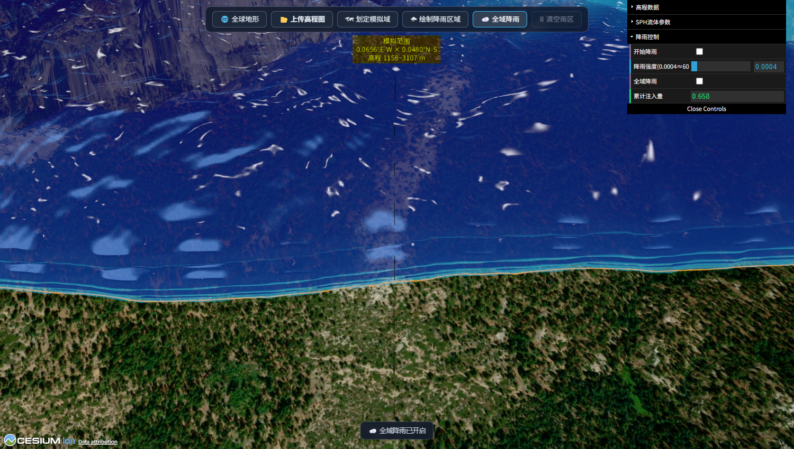
- **排查教训**：判断"有没有水"不能只看 `累计注入量`（CPU 侧统计，只反映"开关打开且存在雨掩膜"），也不能只靠一次截图；应当 ①读回 GPU 纹理确认密度在涨（`gl.readPixels` + `gl.FLOAT`，读 `_outputTexture._texture`），②对**多时刻截图做像素差分**并用蓝通道判据统计占比，两者一致才算可见。

### 6.9 画降雨区域会把模拟域顶替掉（两个编辑器同时挂着拾取 Handler）

- **现象**：用户先画出外层大框作为模拟域，再点「🌧 绘制降雨区域」画内层小框，结果**小框变成了新的模拟域**，大框消失、模拟范围被缩小到雨区大小。
- **根因**：`src/ui/domainEditor.js` 的 `_finishPending()` 提交域后只做 `_commit()` + `_clearPending()`，**没有调用 `stopDrawing()`**。于是 `drawing` 仍为 `true`、它注册的 `Cesium.ScreenSpaceEventHandler` 也一直挂在 canvas 上。用户接着画雨区时 `RainRegionEditor` 又注册了一个 Handler，**两个 Handler 同时接收左键点击**：雨区的每个顶点同时被记进模拟域的暂存顶点，用户右键闭合时两个编辑器一起提交 → 模拟域被雨区的小多边形覆盖并重新启动模拟。
- **修复**：
  - `src/ui/domainEditor.js` `_finishPending()` 末尾补 `this.stopDrawing()`（模拟域只有一个，提交后必须结束绘制并销毁 Handler）。
  - `index.js` 工具栏加**互斥**：点「绘制降雨区域」时若 `domainEditor.drawing` 先 `stopDrawing()`；点「划定模拟域」时若 `regionEditor.drawing` 先 `stopDrawing()` 并取消按钮高亮。`RainRegionEditor` 提交后保持绘制态（支持连续画多个雨区），因此互斥必须由主控保证。
- **回归测试**：`test/verify_region_isolation.mjs` 用**真实鼠标点击**复现：俯视 9000m 点四个角画大框 → 右键闭合 → 等模拟启动 → 点「绘制降雨区域」→ 在框内点四个角画小框 → 右键闭合，然后断言①域顶点数不变②域范围不变③雨区活动数≥1④雨区掩膜已生成⑤流体仍在运行⑥无控制台错误，共 8 项。
- **测试注意**：域提交后主控会 `camera.flyTo` 到域中心（pitch -55°），**画面坐标已改变**，测试若继续用之前的屏幕坐标点击就会落到域外（报"请在模拟范围内部署降雨区域"）。必须在画雨区前重新 `camera.setView` 而对准域中心。

  大框（模拟域）与内层小框（雨区）共存：

  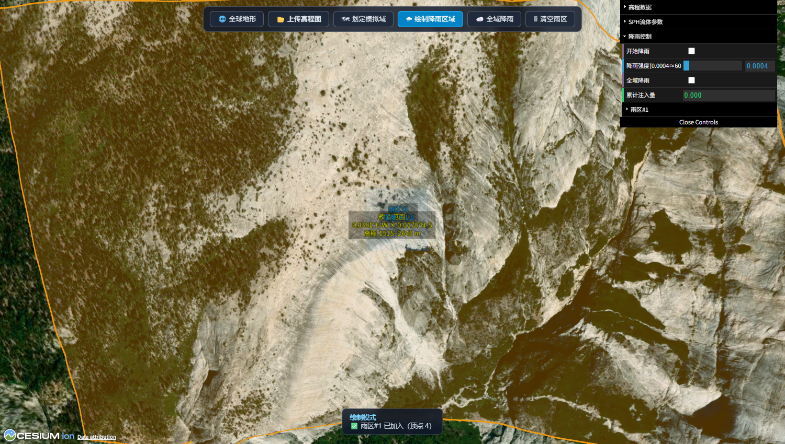

### 6.10 相机贴近地面就看不到水（体积阶段背面剔除把盒内视角剔光）

- **现象**：用户反馈"现在缩放到比较靠近地面就看不到水了"——图中 85 km² 的模拟域、雨区正在降雨、累计注入量在涨、雨丝也在下，但画面上完全没有水体。
- **根因**：`FluidVolumeStage` 的渲染状态用了 `Cesium.CullFace.BACK`。体积盒高度 = 域内高程差（山区可达 1900 m 以上），**相机俯冲/贴近地面时位置落进盒内**，此时盒子的 6 个面相对相机全部是背面，被背面剔除一次性剔光，水体彻底不可见。物理与纹理都正常（`surfaceTexture` 里水量在涨），只是没有片元被光栅化。
- **修复**：见 §5.12——盒内切换为不剔除 + 关深度测试的渲染状态，遮挡改由片元着色器的 `wt < min(tt, ret.y)` 判断。
- **排查方法论**：判断"水体有没有被渲染"必须做**像素级证据**：`gl.readPixels` 对比体积阶段 `show=true/false` 两帧，统计 `diff>24` 的像素比例。修复前盒内该比例为 0，修复后约 100%；只截图看一眼、或只看累计注入量，都会被误导（累计注入量是 CPU 侧统计，与 GPU 是否出图无关）。
- **环境坑**：崩溃的探针脚本会在 Chrome 里遗留多个标签页，每个标签页都跑着 1024² SPH，十几分钟后 GPU/CPU 饱和，连 `/json/list` 都要 120 秒。**探针脚本必须 `try/finally` 关 page**，跑之前先关掉遗留页面。

## 7. 测试体系

`test/` 目录（独立 package，`npm i` 装 puppeteer-core）：

| 文件 | 作用 |
|------|------|
| `server.mjs` | 静态服务器 :8931（服务仓库根目录） |
| `smoke.mjs` | 23 项断言冒烟测试（默认全球模式 + 上传模式 + UTM 投影夹具），输出截图 + `report.json` |
| `make_tiff.mjs` | 生成两份合成 GeoTIFF 夹具：EPSG:4326 与 EPSG:32650(UTM50N)，128²、北亮南暗渐变，两者覆盖同一经纬度范围以便交叉验证 |
| `probe_projection.mjs` | 投影解析纯 Node 单测（7 项）：EPSG:4326 直通、无标签拒判、EPSG:32650 换算、CGCS2000 GK 现场构造定义、退化 bbox 拒绝 |
| `fixture_dem.tif` | 夹具 A 产物（已提交，bbox=[116.2,39.82,116.44,40.06]） |
| `fixture_utm.tif` | 夹具 B 产物（EPSG:32650，与 A 同覆盖范围，用于验证跨坐标系一致性） |
| `verify_fix.mjs` / `verify_align2.mjs` | 视觉验证脚本（非对称雨区 + 多机位截图） |
| `verify_irregular_domain.mjs` | 提交**凸五边形**模拟域 + 全域降雨，截图 `shot_irregular_domain.png` 验证非矩形域精确裁剪水体 |
| `verify_globe.mjs` | 全球模式 12 项：默认模式/按钮状态/五边形采样启动/重复划域/注入/无错误 |
| `verify_globe_top.mjs` / `verify_globe_visual.mjs` | 全球模式正俯视/斜视视觉截图，确认水贴真实山地汇聚、域外无水 |
| `probe_terrain_speed.mjs` | 采样速度探测：固定级别 `sampleTerrain` vs `sampleTerrainMostDetailed`（~70× 差距） |
| `diag_terrain.mjs` | 检查 terrainProvider/影像层数 |
| `bisect_check.mjs` | 着色器编译二分回归：连真 GPU Chrome CDP :9223，提交多边形域后统计错误弹窗/编译错误（§6.6 定位用） |
| `debug_drawrain_gpu.mjs` | 真 GPU 复现脚本（用户报告场景）：load → 划域 → 点「绘制降雨区域」全程统计 error-ish 日志与弹窗，修复后应全为 0 |
| `verify_gpu_fix_visual.mjs` | 真 GPU 划五边形域 + 全域降雨截图 `shot_gpu_fix_visual.png`，并断言无弹窗/无编译错误 |
| `verify_region_isolation.mjs` | **真实鼠标点击级**回归（8 项）：大框画模拟域 → 再画小框雨区，断言域顶点/范围不变、雨区生效、流体仍在跑（§6.9） |
| `verify_visibility2.mjs` / `demo_oblique.mjs` | 降雨可见性回归：俯视 / 斜视多时刻截图，配 `analyze_blue.py` 统计蓝色水面占比变化（§6.8） |
| `probe_area_math.mjs` | 面积公式纯 Node 单测：0.01°×0.01° @34.5°N = 1.0189 km²（理论 1.019）、顶点反序一致、退化输入（§5.8） |
| `verify_area_reset.mjs` | **面积标注 + 重置模拟**回归（17 项）：面积数值合理（多边形 < bbox 且同量级）、三个贴地标签文本、`btnReset` 可用、重置后注入量归零且可重新累计、域与雨区保留、无致命错误（§5.8） |
| `demo_area_labels.mjs` | 生成面积标注演示截图 `shot_area_labels.png`（注意须等 `flyTo` 1.5s 结束后再 `setView`） |
| `verify_features2.mjs` | **参考图层 + 雨滴效果 + 5 档水深配色**回归（29 项）：影像层数=3、道路网/地名标注加载与开关同步、图例 5 行文案与色块、`depthColorEnabled` → uniform 与图例联动、`depthRangeM=depthFullM`、雨滴 stage 开关与像素差 42% 渲染证据、无致命错误（§5.9~§5.11） |
| `probe_ref_speed.mjs` | 页面内测 `ArcGisMapServerImageryProvider.fromUrl` 两层 Reference 的加载耗时与影像层数 |
| `demo_rain_only.mjs` / `demo_showcase.mjs` | 生成文档截图：雨滴下落效果（`rain_fx_close.png`）/ 5 档配色全景（`showcase_wide.png`） |
| `demo_pool.mjs` / `demo_rain_depth.mjs` | 长跑回读 `surfaceTexture` 统计五档直方图 + 多时刻截图（标定 `depthFullM` 用） |
| `verify_features3.mjs` | **中文标注 + 盒内可见性**回归（24 项）：高德层默认创建/显示、开/关像素差 13%、天地图无 tk 不建层/填 tk 建层/取消勾选隐藏、盒外 `_insideBox=false`、盒内（中部/近地面）`_insideBox=true` 且体积贡献像素 >1%（修复前 ≈0）、5 档图例、无致命错误（§5.9 / §5.12） |
| `probe_water_inside2.mjs` | 夹具 DEM 盒内机位高度扫描（:9223）：逐高度打印 `_insideBox`/局部坐标/体积阶段开/关像素差 + 截图，是 §6.10 的定位与验证脚本 |
| `probe_zh_inside.mjs` / `probe_zh_inside2.mjs` / `diag_zh_layer.mjs` | 中文叠加层 / 盒内水平视角出图探针（其中 `diag_zh_layer.mjs` 用来确认影像层顺序，避免后加的底图盖住中文叠加层） |
| `probe_tiles_zh2.mjs` / `probe_tiles_zh3.mjs` | 中文瓦片源探测（页面内 fetch + `createImageBitmap` 统计透明像素）：确认高德 `webst0{s}...style=8&scl=1` 为透明叠加层（不透明像素 8.1%），天地图/Esri/OSM 在当时网络下不可达 |
| `verify_rainfall.mjs` | **雨量模式（按实际降雨量模拟）**回归（35 项）：默认配置与 `massPerMm=1e-4`、等效雨强换算、100mm/10s 注入推进→自动停止且已降雨量 100.000mm、回读 `surfaceTexture` 水体量级合理、1000mm/10s 注满且与 100mm 水体总质量比 10.36≈10、重置后水量/雨量归零、切回强度模式仍按 0.0004 注入、5 档图例、无致命错误（§5.13） |
| `demo_rain_amount.mjs` | 生成雨量模式演示截图：一场 500mm/60s 的雨下完后两雨区的汇水分布与 GUI 面板（`rain_amount_wide.png`/`rain_amount_mid.png`） |
| `demo_shuangshimen.mjs` | **甘肃渭源双石门沟“7·26”山洪复演**：全球地形定位 → 3.5×4.4 km 域 + 1.46 km² 上游雨区 → 雨量模式（50/150 mm per 60 s）→ 回读 `surfaceTexture` 统计湿面/最大水深/5 档 → 出图（`node test/demo_shuangshimen.mjs 150 60 s150`）；先例：雨区顶点必须全在域内、出图前隐藏 polygon/label、等待 `passInjection===0` 再截图（§5.14） |
| `verify_cases.mjs` | **山洪案例库**回归（16 项）：`#btnCases` 开面板、卡片数=4、点卡片出详情、点「▶ 一键复演」进入案例模拟、面板自动关闭、域/雨区面积 >0、雨量参数与案例一致（amount/150mm/60s）、目标质量 >0、状态栏含案例名、注入推进 ≥40mm、**关雨滴后画面像素差分确认水面出现**（蓝色像素 0.23%→2.28%）、无致命错误（§5.15） |
| `verify_precision.mjs` | **模拟精度**回归（18 项）：默认 96²=9,216 采样点、模拟 1024²=1,048,576 格、GUI「地形采样精度/模拟精度」控件存在、切 192² 后点距=跨度/191、模拟格距=跨度/1024、状态栏与精度文本含点数/间距、512² 上限（小范围 1.43×1.73 m/点）、无致命错误（§5.16） |
| `verify_fixes4.mjs` | **水深配色/透明度/累计降雨量**回归（21 项）：GUI 已删「浅水/深水颜色」、降雨行改为「累计降雨量(mm)」、无可拖动分界；分档 = 盒跨度 × 0.2%/0.5%/1%/2% 且图例文案动态；跨两场雨累计 100+200=300mm；水透明度 1→0 画面差分 16.7%，透明度 0 与关水对比 0.58%（≈彻底不可见）（§5.11 / §5.13） |
| `probe_precision.mjs` / `probe_sample_cost.mjs` | 精度探针：前者设采样网格后划域读回 `precisionInfo()`/状态栏；后者实测 96²/160²/256²/384²/512² 的地形采样耗时（§5.16） |
| `probe_cases_geo.mjs` / `probe_cases_terrain.mjs` | 案例静态几何校验（雨区顶点是否都在域内、面积）与地形采样校验（高程范围/起伏/机位地面高程 + 截图） |
| `probe_cases_all.mjs` | 四案例逐一实跑：建域/雨区/注水/机位截图 `case_run_<id>.png`，确认 `rainTotalKm2>0`、`targetMass>0` |
| `probe_datong_area.mjs` | 大通案例候选范围地形起伏对比（5 个 extent 的 min/max/relief），用于把案例坐标调到起伏最明显的沟谷 |

**断言清单**：页面 ready → Viewer 创建 → **默认全球模式（无 DEM/无流体、btnGlobe 存在、划域按钮可用）** → **全球模式画多边形→采样真实地形→生成域掩膜+域约束+流体启动（"🌊 模拟进行中"、sourceMode=globe、bbox=多边形范围）** → 无着色器错误 → **域外雨区被拒绝、域内雨区成功 + 掩膜生成** → 注入持续累加 → 全域降雨开关 → 停止后注入冻结 → GeoTIFF 自动解析 bbox 后划域 → **UTM 投影换算为同区域经纬度**后划域 → PNG 触发手动放置 → 放置范围按宽度与纬度缩放正确后划域 → 无致命控制台错误。

**Node 侧单测**（无需浏览器，秒级）：

```powershell
node test/probe_projection.mjs
node test/probe_area_math.mjs
```

**无头浏览器启动**（本仓库开发时的沙箱环境需要，普通开发机可直接 `puppeteer.launch`）：

```powershell
chrome --headless=new --remote-debugging-port=9222 --user-data-dir=<dir> `
  --no-first-run --no-sandbox --disable-crashpad --disable-crash-reporter
# smoke.mjs 通过 puppeteer.connect({browserURL}) 连接，不自行 spawn
```

> 沙箱坑位记录：node 子进程 spawn EPERM → Chrome 由 pwsh 直接拉起、测试脚本仅 CDP connect；crashpad 子进程被拒 → `--disable-crashpad` + 完整权限。

## 8. 参数调优指南

| 参数 | 位置 | 稳定域 | 说明 |
|------|------|--------|------|
| `rainIntensity` | options / GUI | 0.003~0.02 | 每步每格注入质量。>0.05 压力项平方失稳出尖刺；积水速度 ≈ 值×120/秒 |
| `gravity` | GUI | 1~10（默认4.5） | 同时缩放压力项与地形梯度项，越大流动越快 |
| `initialWaterLevel` | GUI | 0~1 | 初始全覆盖水位（幽灵质量为下限）；0.05 可预铺薄层 |
| `heightScale` | shaders.js | **必须=0.25** | 约束：`DEM编码倍率(4.0) × heightScale = 1`，否则水体沉入/浮出地形 |
| `waterAddRate` | GUI | 0.001~0.1 | 仅点源注水（需勾选 pointSource） |
| `depth` | GUI | 50~500 | 体积渲染光线步进次数（质量/性能权衡） |
| `globeSampleGrid` | options / GUI「地形采样精度」 | 96（预设 96/192/256/384/512） | 全球模式采样网格边长（点数）。点距 = 跨度/(N−1)；越大地形越精细但采样越慢。DEM 与 SPH 网格固定 1024²（§5.16） |
| `reliefMeters` | GUI | 50~3000（默认600） | 上传无参考图片时体积盒竖直厚度 |
| `depthFullM` | GUI「降雨控制」→「雨量换算标定(米)」 | 5~200（默认40） | **雨量→质量换算标定**：`massPerMm = 1/(250×depthFullM)`，只影响雨量模式的注水量，不再参与 5 档配色（配色改按体积盒跨度自动分档，§5.11） |
| `depthColorEnabled` | GUI | 0/1（默认1） | 5 档水深配色开关；关闭回退原「浅水→深水」渐变并隐藏图例 |
| `rainFx` | GUI「雨滴下落效果」 | 布尔（默认 true） | 屏幕空间雨丝后处理开关；仍需「开始降雨」且有启用雨区（§5.10） |
| `refRoads` / `refPlaces` | GUI「标注图层」 | 布尔（默认 true） | ArcGIS Reference 道路网 / 地名标注透明叠加层（§5.9） |
| `refZhAmap` | GUI「标注图层」 | 布尔（默认 true） | 高德中文路网/地名透明叠加层；中国境外无瓦片、GCJ-02 偏移，仅视觉参考（§5.9） |
| `refTdtLabels` / `tdtToken` | GUI「标注图层」 | 布尔（默认 false）/ 字符串 | 天地图中文注记层；tk 需自备（免费申请），为空时勾选只会提示、不建层（§5.9） |
| `rainMode` | GUI「降雨模式」 | `"intensity"` / `"amount"`（默认 intensity） | 强度模式=按雨强连续注水；雨量模式=按累计雨量(mm)+历时注水，下完自动停（§5.13） |
| `rainAmountMm` | GUI「累计雨量(mm)」/「雨量预设」 | 1~1000（默认 50） | 雨量模式本场累计降雨量。按体积守恒换算：1000mm ⇒ 图例水深 1m（`massPerMm = 1/(250×depthFullM)`）（§5.13） |
| `rainDurationSec` | GUI「降雨历时(秒)」 | 10~600（默认 120） | 雨量模式本场降雨历时；等效雨强 = `mm/历时×3600`，只影响注入快慢与雨丝密度（§5.13） |

## 9. 已知限制与 TODO

- **全球地形直接划域（默认模式）**：✅ 已实现，无需上传数据，采样真实高程（§5.7）。固定级别采样优化后启动约 2.3s。
- **投影坐标系 GeoTIFF（UTM / CGCS2000 高斯克吕格 / Lambert 等）**：✅ 已实现自动换算。`src/io/projection.js` 通过 GeoKey 解析 → proj4 转换，覆盖 WGS84 UTM（proj4 内置 326xx/327xx）与需要现场构造定义的中国 CGCS2000 系列（EPSG:4490 等），无地理参考或换算失败时降级手动放置并说明原因。
- **模拟域（任意多边形）**：✅ 已实现"先划域、再划雨区、域内限水"三段式流程（§5.3）。域外质量衰减 + 速度反射 + 渲染裁剪。
- **降雨无物理蒸发/下渗**：纯质量守恒，长期降雨会持续堆积至盒顶。
- **单精度掩膜 8bit**：区域强度 0~2 映射到 0~255，重叠取 max，不支持叠加复合语义。
- **顶点编辑**：模拟域与雨区均暂不支持拖拽顶点/整体平移，只能删除重建。
- **着色器改动红线（ANGLE/D3D11）**：在含 `texelFetch` 的 GLSL 函数内不要写条件 `early return`、不要把 `step(uniform)` 乘进采样结果，否则真机 GPU 上会出现空日志的 "Fragment shader failed to compile"（§6.6）。改 SPH 着色器后应在真 GPU 上跑 `test/debug_drawrain_gpu.mjs` 回归，仅靠无头 SwiftShader 冒烟测试不足以暴露此类问题。
- **iFrame 必须手动递增**：`_buildPipeline` 的 `iFrame` uniform 必须传实例帧计数 `() => this._frame`（由 `_postRenderCb` 每帧递增），不可用局部常量。BufferA 依赖 `if(iFrame<1)` 做一次性初始化；iFrame 恒 0 会导致每帧重置粒子质量、降雨永不累积（§6.7）。这是 Shadertoy→Cesium 移植的关键差异。
- **模拟域顶点校验**：雨区提交时只校验顶点落在域多边形内（`pointInPolygon`），若雨区边跨越域的凹角、顶点都在内但部分边在外，可能出现局部越界 —— 当前域多边形以凸形为主，凹形复杂域建议多布点。
- **性能**：1024² 双子步 SPH 在集显上约 30~60fps；大 DEM（>500MB GeoTIFF）解析内存峰值高（geotiff.js 全量解码），可加分块/金字塔。
- **参考图层依赖外网**：道路网/地名标注来自 ArcGIS Reference 服务，离线或服务受限时只是少两层透明叠加（`console.warn` 后自动跳过），不影响模拟；首屏加载时每层最多等 6 秒（§5.9）。
- **高德中文叠加层的两个限制**：①只覆盖中国境内，境外/远海请求会 404（图层透明，无视觉影响，仅控制台噪声）；②GCJ-02（火星坐标）与 WGS84 影像存在数百米偏移，路名/村庄名位置只能作视觉参考；需要无偏移中文注记时请用天地图 `cva_w`（需自备 tk）。
- **天地图注记需要 tk**：未填 tk 时勾选「中文注记(天地图·需tk)」只会弹提示、不创建图层；填入后自动创建，`tk` 改了会自动重建图层（§5.9）。
- **体积盒内渲染开销**：相机在盒内时体积阶段关闭剔除与深度测试，整屏都在光线步进，但仍是每像素固定步数（`depth` 参数），实测盒内 60fps；若在集显上明显掉帧，可把 GUI「渲染质量」调低（§5.12）。
- **5 档配色的"米"在两套模式下含义不同**：雨量模式下 `massPerMm` 由 `depthFullM` 反推（1000mm ⇒ 1m），图例米数是**真实降雨深度**；强度模式下图例米数只是配色标定值（默认雨强下 `depthFullM=40` 让 1~2 分钟降雨铺满五档），两者不要混用比较（§5.11 / §5.13）。
- **雨量模式为均匀面雨**：雨区内空间均匀、无空间梯度，也不含蒸发/下渗/出流边界；1mm 这类小雨在一场雨里几乎不可见（真实亦如此），要明显积水请用 100~1000mm 或切回强度模式长跑。雨量模式的"水文真实性"到此为止——它是把**总雨量按体积守恒落地**，不是完整水文模型（§5.13）。
- **TODO 候选**：模拟域/雨区导入导出（GeoJSON）；按 DEM 坡向/汇流累积图预置"天然汇水区"；多文件时序降雨（雨强随时间曲线）；将 `_test` 中的交互式视觉脚本整合为 `npm run verify`；雨滴效果支持雨量粒子/落地涟漪。

## 10. 目录结构

```
fluid-sph-rain/
├── index.html                  工具栏/状态栏/GUI 宿主
├── index.js                    主控：数据流、放置、模拟生命周期、GUI、测试钩子
├── src/
│   ├── sim/
│   │   ├── shaders.js          SPH 着色器（rainMask/domainMask 注入、幽灵初始化、heightScale、域边界）
│   │   ├── rainMask.js         雨区多边形 → 掩膜画布（lighten 合成）
│   │   ├── domainMask.js       模拟域多边形 → 域掩膜画布 + pointInPolygon 射线法
│   │   └── geoUtils.js         四空间坐标换算（§5.1 约定的唯一实现处）
│   ├── io/
│   │   ├── elevationLoader.js  GeoTIFF/图片解析 + 边界检测 + NoData
│   │   ├── projection.js       地理参考解析：GeoKey → proj4 → 经纬度 extent
│   │   └── terrainSampler.js   全球模式：采样真实地形高程 → 1024² 灰度 DEM
│   ├── ui/
│   │   ├── domainEditor.js     模拟域（任意多边形）交互绘制/管理
│   │   └── rainRegionEditor.js 降雨区域交互绘制/管理（含域内顶点校验）
│   ├── data/
│   │   └── cases.js            山洪案例库数据（4 个事件：范围/域/雨区/雨量/机位/来源，§5.15）
│   └── render/                 原版渲染阶段（FluidCompute/Volume Stage、纹理工厂）
│       └── rainEffect.js       屏幕空间雨丝后处理（PostProcessStage，§5.10）
├── libs/                       dat.gui / geotiff / proj4（本地化，离线可用）
├── static/                     内置示例高程图（含作者水印）
├── docs/images/                本文档截图
├── test/                       无头浏览器测试（见 §7）
└── Cesium/                     Cesium 1.132（内置，勿动）
```

---

## 致谢与声明

- SPH 着色器移植自 [shadertoy 7tSSDD](https://www.shadertoy.com/view/7tSSDD) 与 [shadertoy l33Sz8](https://www.shadertoy.com/view/l33Sz8)，Cesium 移植与原始架构来自 [少年啦1997/fluid-sph](https://github.com/shaonianla1997/fluid-sph)，本项目为其学习用途的增强开发版，原作者声明（见 README）继续有效，**禁止商用售卖**。
- 内置示例高程图版权归原作者所有，仅作演示。


