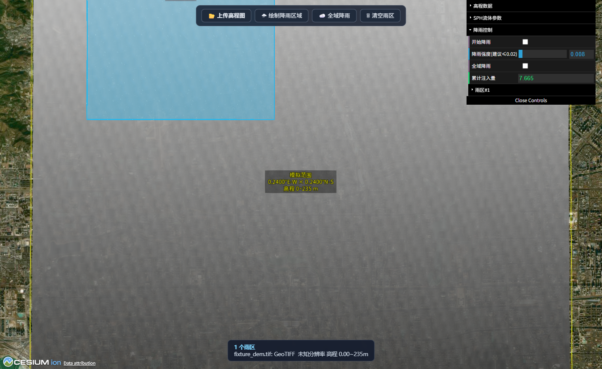
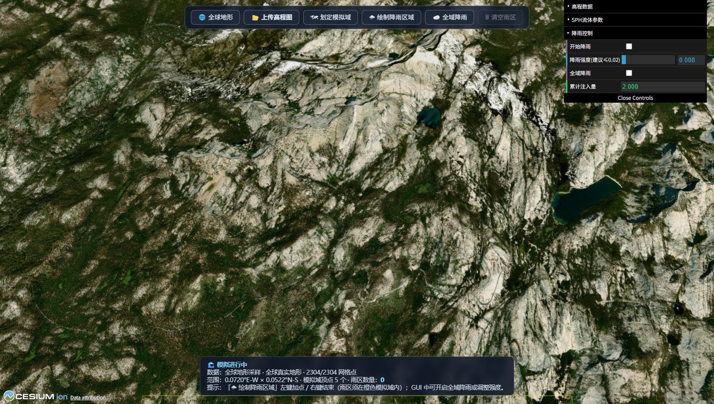

# fluid-sph-rain 开发文档

> 基于 [少年啦1997] 的开源项目 [fluid-sph](https://github.com/shaonianla1997/fluid-sph)（Cesium SPH 地形流体模拟）的增强开发版。
> 本文档面向后续开发者，完整记录功能实现、架构设计、关键技术决策、修复过程与测试体系。
> 使用说明请先看 [README.md](README.md)，本文档侧重"为什么这么写"与"如何继续开发"。

---

## 目录

1. [功能总览](#1-功能总览)
2. [效果展示](#2-效果展示)
3. [快速开始](#3-快速开始)
4. [系统架构](#4-系统架构)
5. [核心技术细节](#5-核心技术细节)
   - 5.1 [坐标系与方向约定（必读）](#51-坐标系与方向约定必读)
   - 5.2 [高程图加载与覆盖范围解析](#52-高程图加载与覆盖范围解析)
   - 5.3 [模拟域（任意多边形）与域掩膜](#53-模拟域任意多边形与域掩膜)
   - 5.4 [降雨区域与掩膜管线](#54-降雨区域与掩膜管线)
   - 5.5 [SPH 着色器改动](#55-sph-着色器改动)
   - 5.6 [基础地形与底图](#56-基础地形与底图)
   - 5.7 [全球地形直接划域（地形采样）](#57-全球地形直接划域地形采样)
6. [关键修复记录](#6-关键修复记录)
7. [测试体系](#7-测试体系)
8. [参数调优指南](#8-参数调优指南)
9. [已知限制与 TODO](#9-已知限制与-todo)
10. [目录结构](#10-目录结构)

---

## 1. 功能总览

在上游"固定 PNG 高程图 + 固定经纬度范围"的基础上，实现四项核心需求：

| # | 需求 | 实现 | 关键模块 |
|---|------|------|----------|
| 0 | **默认：无需上传数据，直接在当前全球地形上画任意多边形区域即可模拟** | 打开页面即全球卫星地形 → 左键在地表画多边形 → 系统自动采样该区域真实高程生成 DEM → 域掩膜限水 → 启动模拟 | `src/io/terrainSampler.js` + `src/ui/domainEditor.js`（自由模式） |
| 1 | 上传高程图（tif/png 等），系统自动分析覆盖范围并划定模拟区域（**可选入口**） | GeoTIFF 解析地理参考得 bbox；普通图片自动裁边 + 底图点击放置（自动采样地形高程贴地）；覆盖范围作为模拟域的可选边界 | `src/io/elevationLoader.js` |
| 2 | 先划定**任意多边形模拟域**，水体被严格限制在域内 | 上传只做"准备"（解析范围 + DEM 叠置），玩家在高程图范围内点选顶点闭合多边形 → 栅格化为 1024² 域掩膜 → 同时约束物理与渲染 | `src/sim/domainMask.js` + `src/ui/domainEditor.js` |
| 3 | 在模拟域内划定一个或多个降雨区域 | 地球表面交互绘制多边形（任意数量），**提交时校验所有顶点落在模拟域内**，实体贴地渲染，每区域独立参数面板 | `src/ui/rainRegionEditor.js` |
| 4 | 降雨区域累加雨量并实时流体模拟 | 雨区栅格化为 GPU 掩膜纹理，SPH 模拟步内持续注入质量 → 贴地积蓄 → 沿地形汇流，域外质量衰减/速度反射/渲染裁剪 | `src/sim/rainMask.js` + `src/sim/shaders.js` |

顺带完成的基础增强：

- **默认全球地形模式**：不需要任何 DEM 文件，打开即可在真实卫星地形上划域模拟；地形采样用固定级别 `sampleTerrain`（比 `sampleTerrainMostDetailed` 快约 70×，见 §5.7）。
- **去 Token 化运行**：无 Cesium Ion Token 时自动使用 ArcGIS 全球地形（WorldElevation3D）+ ArcGIS 卫星影像，均免密钥；配置 Token 则优先 Ion 底图 + Cesium World Terrain；离线自动降级（仅影响显示，不影响模拟）。
- **DEM 叠置可视化**：高程图以影像层贴在真实地形上显示，配合黄色范围框与标注，"覆盖范围"一目了然。
- **模拟环境可重建**：切换数据时完整销毁旧的渲染管线/实体/影像层，可反复上传不同数据。

## 2. 效果展示

**合成 GeoTIFF 上传后自动定位 + 雨区水体对齐（正俯视）**：



**水体贴附真实地形表面（斜视，样例=加州 Sierra 真实 DEM）**：


**低角度侧视：薄层沿山势汇流，洼地变深、山谷外溢**：


**ArcGIS 卫星影像 + 全球地形底图**：


**任意多边形模拟域：水体被橙色五边形边界精确裁剪，域外无水**：


**默认全球地形模式：直接在真实卫星地形上画五边形区域，自动采样高程并模拟**：



## 3. 快速开始

### 运行应用

```bash
# 任意静态服务器指向仓库根目录即可
npx http-server -p 8080
# 或 python -m http.server 8080
# 浏览器打开 http://127.0.0.1:8080（需 WebGL2，Chrome/Edge 现代版本）
```

打开页面**默认就是全球地形模式**（打开即见真实卫星影像 + 3D 地形），完整操作流程：

1. **直接在地形上画模拟域**：左键在任意地表逐点添加顶点，右键 / 双击 / 回车闭合（≥3 点）。提交后系统自动采样该多边形范围内的真实高程（见 §5.7），生成域掩膜并启动模拟。无需上传任何数据。
2. **（可选）改用自有高程图**：点「📂 上传高程图」→ GeoTIFF 自动解析覆盖范围 / 普通图片按提示点击放置 → DEM 叠置到地形上，同样进入"请划定模拟域"阶段。
3. **在域内绘制雨区 / 开启降雨**：点击「🌧 绘制降雨区域」在模拟域内画多边形（顶点必须全部落在域内），GUI 勾选「开始降雨」；或直接用「全域降雨」给整个模拟域注水。
4. 随时点「🌐 全球地形」回到默认模式重新划域。

水体被严格限制在橙色模拟域边界内，域外无水。

### 运行测试（无头浏览器冒烟测试，23 项断言）

```bash
cd test
npm i                # 安装 puppeteer-core
# 需要本机 Chrome；如路径不同：
#   set CHROME_PATH=C:\path\to\chrome.exe
# 终端 1：node server.mjs     （静态服务器 :8931）
# 终端 2（可选）：手工启动 headless Chrome，见 test/smoke.mjs 头注释
npm test             # node smoke.mjs
```

测试内容：默认全球模式（无 DEM/无流体） / **全球划域→采样真实地形→启动（域掩膜+域约束）** / 域外雨区被拒绝、域内雨区成功 / 雨区→掩膜→注入累加→停止 / 全域降雨 / GeoTIFF 自动定位后划域 / UTM 投影换算后划域 / PNG 手动放置后划域 / 无致命错误。输出 `report.json` 与截图。另有 `verify_irregular_domain.mjs`（上传模式凸五边形域）、`verify_globe.mjs`（全球模式 12 项）、`verify_globe_top.mjs`（正俯视视觉）等专项脚本。

## 4. 系统架构

```
index.html ──┬── Cesium 1.132（内置）
             ├── libs/dat.gui.min.js     GUI 面板
             ├── libs/geotiff.min.js     GeoTIFF 解析（UMD 全局 GeoTIFF）
             ├── libs/proj4.js           投影坐标系转换（UMD 全局 proj4）
             └── index.js (module)       主控
                    │
   ┌────────────────┼────────────────────────────────┐
   │ 数据流（两条入口，最终都产出 dem + 多边形域）   │
   │ 【默认·全球模式】用户在真实地形上画多边形       │
   │   DomainEditor(freeMode).onChange → domain.extent(多边形bbox)
   │      → sampleTerrainDem(provider, bbox) → dem{canvas, min/max, extent}
   │      → onDomainCommitted → flyTo + addRangeOutline
   │ 【可选·上传模式】                              │
   │  File → elevationLoader → ElevationData         │
   │  {canvas 1024²灰度, min/max, extent|null, info} │
   │      │ extent 有效 → prepareDomain()（叠置+划域提示，未启动）
   │      │ extent 为空 → pendingPlaceDem → 点击底图  │
   │      │                → 采样地形高程            │
   │      ▼                                          │
   │  用户绘制任意多边形模拟域 → DomainEditor.onChange │
   │      ──▶ rasterizeDomainMask → onDomainCommitted  │
   │      ──▶ regionEditor.setDomain(域多边形)          │
   │      ──▶ startSimulation:                        │
   │    TerrainFluidSimulation(viewer, dem, options)  │
   │      ├─ 5 个 Primitive 阶段（GPU 管线）           │
   │      │   BufferA 积分/初始化 (particleTexture)    │
   │      │   BufferB 物理+注入   (simulationTexture)  │
   │      │   BufferC 平滑高度场   (surfaceTexture)    │
   │      │   History 回写         (historyTexture)    │
   │      │   Volume 光线步进渲染  (盒体 DrawCommand)  │
   │      ├─ setRainMask(canvas)   重建雨区掩膜纹理    │
   │      └─ setDomainMask(canvas) 重建域掩膜纹理      │
   │                                                  │
   │ 交互流                                            │
   │  工具栏 ── DomainEditor（先） ─▶ 域掩膜 ─▶ 模拟启动 │
   │  工具栏 ── RainRegionEditor（后） ── onChange     │
   │      ──▶ rasterizeRainMask(区域列表) ──▶ fluid    │
```

- **双入口主控流程**：
  - 全球模式（默认）：打开 → `startGlobalDomainDraw()` → 用户在地形上画多边形 → `DomainEditor(freeMode)._commit` 由多边形 bbox 反推 `domain.extent` → `onDomainCommitted(domain)`（async）→ 采样真实地形生成 dem → `addRangeOutline` + `flyTo` → `finishStart(dem, domainMaskCanvas)`。
  - 上传模式（可选）：`handleUploadFile` → `prepareDomain(dem)`（解析 + 叠置 + `domainEditor.startDrawing(dem.extent)`，**不启动模拟**）→ 用户闭合并提交多边形 → `onDomainCommitted(domain)`（复用 pendingDomainDem）→ `finishStart(...)`。
  - 二者都保证"先划模拟域、再在域内划雨区"。
- 体积盒用 dem 覆盖范围生成（全球模式=多边形 bbox，上传模式=高程图覆盖范围；保证 heightMap uv 与着色器 uv 对齐、地形不错位）；模拟域只是盒内的一个多边形，通过 1024² 域掩膜表达。
- 上游管线每帧执行 **两次物理子步**：`BufferB(simulationTexture)` 与 `simulationHistoryStage`（同一着色器再跑一遍写 historyTexture），注入发生在两处（同一掩膜、同一强度），累加语义一致。
- 每次切换数据调用 `teardownSimulation(true)`：销毁 5 个阶段、4 张模拟纹理、DEM/掩膜纹理、边界实体、叠置层，并清空雨区。

## 5. 核心技术细节

### 5.1 坐标系与方向约定（必读）

整条链路存在**四个空间**，方向约定错误会表现为"雨区与水体位置镜像/错位"。当前约定如下，**改动任何映射前先读懂本节**：

| 空间 | 定义 | 北在哪 | 换算 |
|------|------|--------|------|
| 地理 | 经纬度（Cartographic） | — | — |
| 粒子/着色器 uv | `pos / 1024`，gl_FragCoord 原点在左下 | `v = 0` | `u = lonNorm`，`v = 1 - latNorm` |
| 画布（DEM/掩膜） | 1024² 位图，flipY:false 直传 GPU，纹理第 0 行 = 画布顶部 | `y = 0`（顶部） | `x = u·S`，`y = v·S`（v 为着色器空间值） |
| 体积盒模型空间 | BoxGeometry 单位立方 ±0.5，`getHeight` 用 `p.xz+0.5` 作 uv | `v = 0`（p.z = -0.5 端） | 模型矩阵 `rotX(90°)` 使 local Y→UP、local Z→南向，因此 p.z=-0.5 恰为北端 ✓ |

推导要点（曾两次在此翻车，见 §6）：

- 原版 `centeredY = 1 - y` 的翻转发生在"经纬度 → 着色器空间"这一步；
- 掩膜画布与 DEM 编码同为 north-up 位图直传（flipY:false），着色器 v=0 采样纹理第 0 行 = 画布顶部 = 北，所以**画布 y 直接用 v，不要再取反**；
- 体积盒 `generateModelMatrix([90,0,0])` 的旋转把模型 Z 轴转到 -North，`p.z+0.5` 的 v=0 恰好对应北端——与 DEM 行序天然一致，**无需额外翻转**。

统一换算函数在 `src/sim/geoUtils.js`：`cartoToSimUV` / `cartoToCanvasPx` / `rectangleAroundCenter`。

### 5.2 高程图加载与覆盖范围解析

`src/io/elevationLoader.js`，入口 `loadElevationFile(file)`，输出统一结构：

```js
{ kind, sourceName, canvas /*1024²灰度,R通道=归一化高程*/,
  minElevation, maxElevation,
  extent /*[minLon,minLat,maxLon,maxLat]|null*/,
  contentAspect, info }
```

- **GeoTIFF 分支**：`GeoTIFF.fromArrayBuffer` → `image.getBoundingBox()` 得 bbox → `resolveGeoReference()` 解析地理参考（见下）；`readRasters({samples:[0],width:1024,height:1024,resampleMethod:"bilinear"})` 重采样；`getGDALNoData()` 剔除无效像元后统计 min/max；行序保持原栅格（北在上）直接编码画布。
- **地理参考解析**（`src/io/projection.js`，`resolveGeoReference(fileDir, bbox)`）：区分两种坐标系——
  - **地理坐标系**（`GTModelType=2`，或 bbox 落在经纬度合法区间）：bbox 直接作为 extent，单位显示为 `°/px`；
  - **投影坐标系**（`GTModelType=1`）：先看 `ProjectedCSType` GeoKey 的 EPSG 编码是否被 proj4 内置（WGS84 UTM 326xx/327xx、3857 等）；不内置（如 CGCS2000 的 EPSG:4490/4547）则按 `ProjCoordTrans` + `ProjNatOriginLong/Lat`、`ProjFalseEasting/Northing`、`ProjScaleAtNatOrigin`、`ProjStdParallel1/2` 现场拼 `+proj=…` 定义串，椭球按 `GeographicType` 映射（4490/4258/4269→GRS80、4267→clrk66、其余→WGS84）。换算用 **7×7 网格采样**取经纬度外包，而非只取四角——横轴墨卡托下经度沿东西向非线性，只取角点会失真。
  - **兼容性坑**：geotiff.js 各版本 `fileDirectory` 表示不同——旧版是数组且 tag 名带 `Tag` 后缀（`ModelPixelScaleTag`），新版返回普通对象（键为 `"0","1",…`）且名无后缀（`ModelPixelScale`）。`asIndexed()` / `tagArray()` 两种都归一化，否则 GeoKey 全部解析为空、投影图纸被误判"未知投影"。
  - 换算失败或无地理参考时 `extent=null`，走手动放置并给出具体原因（`geoRef.note`）。
- **普通图片分支**：`createImageBitmap` → 缩到 ≤2048 分析 → `detectContentBounds()` 识别纯色边框/透明边并裁剪（边缘环取主色调，占比 >40% 才认定为边框；裁剪面积 <4% 或 >99.5% 放弃裁剪防误判）→ 亮度转灰度 → 默认高程 0~1000m。
- **手动放置 + 贴地**：`index.js#placePendingDemAtDegrees` 点击中心后，`rectangleAroundCenter` 按放置宽度算 bbox（经度除 cos(纬度)），再 `sampleTerrainMostDetailed` 采样四角+中心真实高程，`min/max = 地面 -0.1/×0.9 × reliefMeters`，保证盒子浮在真实地表上而非埋入地下。

### 5.3 模拟域（任意多边形）与域掩膜

**为什么需要它**：原版水体只能装在"高程图覆盖范围"这个矩形盒里，用户无法指定不规则的计算边界。改为先在高程图范围内画任意多边形作为模拟域，水体被严格限制在域内。

**交互编辑器** `src/ui/domainEditor.js`：工具栏「🗺 划定模拟域」按钮激活后，左键在高程图覆盖范围内逐点添加顶点（点前会校验 `_withinExtent`），右键 / 双击 / 回车闭合（≥3 点），Esc 取消。橙色 `#f59e0b` 贴地多边形 + 顶点标记可视化。提交结果 `domain = { simPoly, cartos, label }`，`simPoly` 是着色器空间 uv 顶点数组。

**栅格化** `src/sim/domainMask.js`：`rasterizeDomainMask(simPoly)` 把多边形填成 1024² 黑白画布（黑底 + 白域），坐标 `y = v·S` 与高程图/雨掩膜同 north-up 约定（§5.1）；`pointInPolygon(u, v, poly)` 射线法供雨区顶点校验。

**三重约束**（`src/sim/shaders.js` + `rainRegionEditor`）：

1. **物理层**：`Simulation()` 末尾，若 `domainEnabled > 0.5`，采样 `domainMask`：域外格子质量按 `mix(0.85, 0.0, step(dom,0.1))` 衰减（越界越狠），并用 `domainNormal()`（掩膜梯度，指向域内）反射速度，`vn<0` 的入射分量被抵消 —— 水撞到域边界会被弹回而非漏出。
2. **降雨注入**：`P.M.x += rainIntensity × dt × texture(rainMask,suv).r × texture(domainMask,suv).r` —— 全域降雨也不会往域外注水。
3. **渲染层**：`surfaceSmoothingSource` 输出水密度乘 `domainAt(pos)`（域外为 0），域外绝对不渲染水面；地形高度不受影响。

`fluid.setDomainMask(canvas, enabled)` 管理域掩膜纹理（未启用时回退 1×1 全白纹理，等效无约束）。域多边形切换数据时随 `teardownSimulation(true)` 一并清理。

> 调试教训（§6.4）：`_renderDomain()` 曾误调 `clearDomain(false)` 把刚设置的 `this.domain` 清空，导致 onChange 收到 null、模拟始终不启动；重写为只移除实体。另 `_commit()` 里 `_status()` 必须放在 `_notifyChanged()` **之前**，否则主控在 finishStart 设置的"模拟进行中"会被"模拟域已划定"覆盖。

### 5.4 降雨区域与掩膜管线

```
编辑器多边形(着色器空间uv) ──rasterizeRainMask──▶ 1024² 画布
   区域填充灰度 = clamp(intensity,0,1)×255
   合成模式 lighten（逐通道取 max → 重叠区取最大强度）
   全域降雨 = 先铺满白再叠区域
        │ toDataURL 不需要——画布直接作 Cesium.Texture source
        ▼
fluid.setRainMask(canvas) ──▶ RGBA UNSIGNED_BYTE 纹理（LINEAR/CLAMP）
        ▼
着色器 Simulation()：P.M.x += rainIntensity × dt × texture(rainMask, uv).r
```

- 区域增删/启停/改强度 → `editor.onChange` → `applyRainRegions()` 重建画布 → `setRainMask` 销毁旧纹理重建新纹理（低频操作，开销可接受）。
- 无任何雨区且未开全域时传 `null`，uniform 回退到 1×1 黑纹理，`rainIntensity` 归零，零开销。
- 编辑器实体：填充多边形（不指定 height → Cesium 自动 GroundPrimitive 贴地）、`clampToGround` 边界线、贴地标注（强度实时刷新）。

### 5.5 SPH 着色器改动

`src/sim/shaders.js`（从 index.js 抽出，便于复用与审阅）：

1. **新增 uniform**：`rainIntensity`（全局强度，开关关闭时 CPU 侧传 0）、`rainMask`（采样器）、`domainMask`（域掩膜采样器）、`domainEnabled`（域约束开关，0/1）。辅助函数 `domainAt(pos)`（取域内程度）、`domainNormal(pos)`（掩膜梯度法向，指向域内）。所有掩膜采样统一走 `texelC()` 宏（`texelFetch` + clamp 整数像素），规避 `texture()` 在非均匀控制流下的隐式导数问题。**ANGLE/D3D11 兼容红线（§6.6）**：这两个含 `texelFetch` 的函数内绝不能写条件 `early return`，也不能把 `step(uniform)` 乘进采样结果；未启用域时 CPU 侧绑定全白纹理，`domainAt` 天然返回 1.0、梯度天然为 0，因此无需任何运行时判断。
2. **注入点**：`Simulation()` 在原"点源注水"后新增掩膜注入（BufferB 与 History 两个阶段共用，与上游双子步设计一致），注入量再乘 `domainMask` 保证域外不注水；`Simulation()` 末尾追加域边界约束（§5.3 物理层）。
3. **全覆盖幽灵初始化**（BufferA）：原版 60% 格子初始化粒子、40% 空格 → 降雨只落在 60% 格子、附着斑驳。改为**每格都初始化 1e-6 幽灵质量**（`max(initialMass, 1e-6)`），雨水可附着于任意地表格，逐渐积蓄成可见薄层。幽灵质量对压力项贡献可忽略，不改变无雨区外观。
4. **heightScale = 0.25（高程对齐，见 §6.3）**：`getHeight` 的 `terrainH = data.y × heightScale - 0.5`，而 `terrainHeight = DEM归一化 × 4.0`，故 `4.0 × 0.25 = 1` → 盒内地形精确铺满体积盒的 `[minElevation, maxElevation]` 绝对高程区间，与真实地形重合，水面才会"贴"在看得见的地表上。**改 DEM 编码倍率或 heightScale 时必须保持该乘积为 1。**

### 5.6 基础地形与底图

`index.js#initViewer` 加载链：

| 层 | 有 Token | 无 Token（默认） | 失败降级 |
|----|----------|------------------|----------|
| 地形 | `CesiumTerrainProvider.fromIonAssetId(1)` | `ArcGISTiledElevationTerrainProvider.fromUrl(elevation3d.arcgis.com/.../Terrain3D/ImageServer)` | 椭球面（不影响模拟） |
| 底图 | Viewer 默认 Ion 影像 | `ArcGisMapServerImageryProvider.fromUrl(server.arcgisonline.com/.../World_Imagery)` | OSM → 无底图 |

实测本机网络：`server.arcgisonline.com` 与 `elevation3d.arcgis.com` 可达，`tile.openstreetmap.org` 不通，故 ArcGIS 优先。两个域名常量在 `BASEMAP_SOURCES`。

贴地渲染：雨区实体/范围框/标注全部 `CLAMP_TO_GROUND` 或 GroundPrimitive；模拟范围框 `heightReference: RELATIVE_TO_GROUND, height: 150`。

### 5.7 全球地形直接划域（地形采样）

默认模式。用户不上传任何数据，直接在全球卫星地形上画多边形，`src/io/terrainSampler.js` 负责把该区域真实高程转成 SPH 需要的 1024² 灰度高度图：

1. **范围来源**：多边形提交时（freeMode）由顶点经纬度 bbox 反推 `domain.extent`（十进制度），同时作为体积盒范围（与上传模式的 dem.extent 等价）。
2. **采样策略（性能关键）**：在 bbox 内铺 `globeSampleGrid × globeSampleGrid`（默认 96，GUI 可调 32~160）个 `Cartographic` 网格点（v=0 为北，与全链路 north-up 约定一致）。
   - 优先用 `Cesium.sampleTerrain(provider, level, positions)` 固定级别采样，级别由区域跨度自适应：`ideal = log2(360 / spanDeg) + 1.3`，clamp 到 8~15。
   - 失败才退化到 `sampleTerrainMostDetailed`。
   - **实测性能差约 70×**：固定级别 12 采样 32×32 点耗时 ~147ms，而 `sampleTerrainMostDetailed` 同样点数需 ~10231ms。这正是不能图省事直接用 mostDetailed 的原因（会卡界面 10 秒以上）。
3. **高程归一化**：`Float64Array` 存采样高程，NaN 用最近有效值填充；统计 min/max 后上下各留 5% 余量（跨度 <1m 时给 ±5m）；`encodeHeightGrid()` 双线性插值放大到 1024² 灰度画布，`g = (h - min) × 255 / (max - min)`（行 0 = 北），喂给着色器 heightMap。
4. **模拟框相机**：采样完成后 `flyTo` 到 bbox（留 0.4× 边距、pitch -55°、1.5s），便于观察贴地汇流。
5. **降级**：无可用地形 provider 或采样全部失败时构造平坦 DEM（`flat=true`），模拟仍可运行，只是高度场为常数。

验证：`test/verify_globe.mjs`（12 项）覆盖默认模式、五边形采样启动、重复划域、注入等，ALL PASS；`sampleTerrain` 优化后全球划域启动耗时从 ~36.7s 降到 ~2.3s。视觉截图 `docs/images/06_globe_domain.png` 显示水体随真实山地起伏汇聚、域外无水。

## 6. 关键修复记录

五个踩坑极深的 bug + 一个状态栏覆盖问题，记录根因与验证方法，避免后续重蹈（§6.4/§6.5 为模拟域改造新增，§6.6 为真机 GPU 着色器编译失败）：

### 6.1 雨区与水体 N-S 镜像（掩膜画布 y 取反）

- **现象**：非对称雨区画在西北，水体出现在镜像位置。
- **根因**：掩膜画布 y 写成 `(1 - v)·S`。着色器 v=0 是北、画布 y=0 也是北，两者**同向**，应写 `y = v·S`（推导见 §5.1）。
- **为什么当初测试没发现**：自动化验证用的是**中心对称矩形**，镜像后与自身重合。教训：**对齐类测试必须用非对称图案**（后来用"西北象限多边形 + 南北渐变合成 DEM"暴露并验证）。
- **修复**：`src/sim/rainMask.js` 坐标公式；`geoUtils.js` 注释同步。

### 6.2 降雨尖刺失稳（注水过载 + 附着载体不全）

- **现象**：雨区出现大量竖直尖刺状"晶体"，不是贴地水层。
- **根因**：① 默认雨强 0.05 × 每帧 2 子步 × 60fps = 每秒每格 +6 质量，SPH 压力项 `∝ M0·(M+M0)` 随质量**平方**增长，粒子高频震荡 → 密度场高频噪声被 heightScale 放大成尖刺；② 原版 40% 格子无粒子，雨水无处附着。
- **修复**：默认雨强 0.008（GUI 上限 0.1、建议 ≤0.02）+ 全覆盖幽灵初始化（§5.5 第 3 条）。

### 6.3 水体沉入地形下方（heightScale 不匹配）

- **现象**：水体从雨区多边形上"脱开"，斜视角下投影偏移、看起来在地面以下，汇聚的水被埋住不可见。
- **根因**：盒内渲染地形只占盒子竖直跨度的 60%（`4.0 × 0.15 = 0.6`），而盒子按真实 `[min,max]` 绝对高程放置 → 内嵌地形比真实地表低约 40% 高差（样例约 700m）。雨区多边形贴真实地形，水体在盒内偏低地形上，斜视角下产生大幅屏幕投影偏移。
- **修复**：`heightScale = 0.25` 使内嵌地形精确铺满盒子高程区间（§5.5 第 4 条）。
- **验证**：侧视截图确认水体完整贴附山体表面、洼地变深、沿山谷外溢。

### 6.4 模拟域提交后模拟不启动（_renderDomain 误清数据）

- **现象**：提交模拟域后状态栏显示"✅ 模拟域已划定"，但流体从未创建，冒烟测试报 `hasMask/domainEnabled=false`。
- **根因**：`DomainEditor._commit()` 顺序为 `this.domain={…} → _renderDomain(cartos) → _notifyChanged()`，而 `_renderDomain()` 内部第一行 `this.clearDomain(false)` 把刚设置的 `this.domain` 置 null（`clearDomain` 无论 notify 与否都会清空数据）。于是 onChange 收到 null → 主控 `if(!domain)return` 直接返回 → `onDomainCommitted` 未调用。
- **修复**：`_renderDomain()` 改为只移除实体 `for(const e of this._domainEntities.splice(0)) viewer.entities.remove(e)`，绝不清 `this.domain`。
- **验证**：冒烟断言 `commitTestDomain` 返回 `ok:true/vertices:4/hasMask:true/domainEnabled:true`，状态"🌊 模拟进行中"。

### 6.5 状态栏被覆盖（回调顺序）

- **现象**：模拟域提交成功、流体已启动，但状态栏停在"✅ 模拟域已划定"而非"🌊 模拟进行中"，冒烟断言失败。
- **根因**：`_commit()` 里 `_notifyChanged()`（同步触发主控 `finishStart` 设置"🌊 …"）在 `_status("✅ …")` **之前**，编辑器自己的状态后写入把它覆盖了。
- **修复**：`_commit()` 里先 `_status("✅ 模拟域已划定")` 再 `_notifyChanged()`，让主控状态最后写入胜出。
- **教训**：同步回调链里的状态写入顺序决定最终显示；"谁最后写谁赢"，枢纽状态应在回调之后不再被覆盖。

### 6.6 真机 GPU 上"Fragment shader failed to compile"（空日志）

- **现象**：用户点击「绘制降雨区域」后，Cesium 弹窗 "An error occurred while rendering. Rendering has stopped." + `RuntimeError: Fragment shader failed to compile. Compile log:`（**日志为空**），渲染停止。无头 SwiftShader Chrome 下**无法复现**，冒烟测试曾误报 ALL PASS（致命错误正则漏了 "failed to compile" 措辞）。
- **真实触发点**：并非按钮点击本身（按钮只调 `regionEditor.startDrawing`），而是**划域提交后流体管线首次渲染**时，失败的着色器是 SPH 计算着色器（含 `Simulation`/`Reintegration`/`main`），非体积渲染着色器。
- **定位方法**：真 GPU Chrome（ANGLE / NVIDIA RTX 3080 Ti / D3D11）CDP + 二分法（`test/bisect_check.mjs`，提交多边形域后统计错误弹窗与编译错误）。关键对照：① 换成 pre-domain 着色器（git `7b35e72`）→ 同机正常（排除环境）；② 把失败着色器源码放到**全新裸 WebGL2 上下文**编译 → `ok:true`（排除 GLSL 语法）；③ 逐个增减 domain 辅助函数变体。
- **根因**：**ANGLE/D3D11 的 GLSL→HLSL 翻译器缺陷**——在含 `texelFetch` 的函数里，写**条件 `early return`**（`if(domainEnabled<0.5) return ...`）**或把 `step(uniform)` 乘进采样结果**，会生成非法 HLSL，导致编译失败且日志为空。二者任一都会触发；采样次数本身不是阈值（4 次采样无 early return/stable 可编译）。ShaderToy/SwiftShader 的宽松编译器不暴露该问题。
- **修复**（`src/sim/shaders.js`）：`domainAt()`、`domainNormal()` 去掉条件 early return 与 step 乘算，改为**纯采样表达式**（`return texelC(domainMask, worldPos).r;` / `.r` 梯度 `vec2(r-l, u-d)`）；依赖"未启用域绑定全白纹理"使返回值天然中性（1.0 / 0 梯度），无需运行时判断；两函数上方加 ANGLE 兼容注释。同步把冒烟测试致命错误正则补全 `failed to compile|translation failed|Fragment shader failed|An error occurred while rendering`。
- **验证**：`test/bisect_check.mjs` FINAL → dialog=0/compileErr=0；`test/debug_drawrain_gpu.mjs` 真 GPU 上 load/domain/draw-rain 全程 0 错误、0 弹窗；`test/smoke.mjs` 23 项 ALL PASS；`test/verify_gpu_fix_visual.mjs` 真 GPU 截图 `test/shot_gpu_fix_visual.png` 确认水体贴山地汇聚、域外无水、卫星影像正常。

## 7. 测试体系

`test/` 目录（独立 package，`npm i` 装 puppeteer-core）：

| 文件 | 作用 |
|------|------|
| `server.mjs` | 静态服务器 :8931（服务仓库根目录） |
| `smoke.mjs` | 23 项断言冒烟测试（默认全球模式 + 上传模式 + UTM 投影夹具），输出截图 + `report.json` |
| `make_tiff.mjs` | 生成两份合成 GeoTIFF 夹具：EPSG:4326 与 EPSG:32650(UTM50N)，128²、北亮南暗渐变，两者覆盖同一经纬度范围以便交叉验证 |
| `probe_projection.mjs` | 投影解析纯 Node 单测（7 项）：EPSG:4326 直通、无标签拒判、EPSG:32650 换算、CGCS2000 GK 现场构造定义、退化 bbox 拒绝 |
| `fixture_dem.tif` | 夹具 A 产物（已提交，bbox=[116.2,39.82,116.44,40.06]） |
| `fixture_utm.tif` | 夹具 B 产物（EPSG:32650，与 A 同覆盖范围，用于验证跨坐标系一致性） |
| `verify_fix.mjs` / `verify_align2.mjs` | 视觉验证脚本（非对称雨区 + 多机位截图） |
| `verify_irregular_domain.mjs` | 提交**凸五边形**模拟域 + 全域降雨，截图 `shot_irregular_domain.png` 验证非矩形域精确裁剪水体 |
| `verify_globe.mjs` | 全球模式 12 项：默认模式/按钮状态/五边形采样启动/重复划域/注入/无错误 |
| `verify_globe_top.mjs` / `verify_globe_visual.mjs` | 全球模式正俯视/斜视视觉截图，确认水贴真实山地汇聚、域外无水 |
| `probe_terrain_speed.mjs` | 采样速度探测：固定级别 `sampleTerrain` vs `sampleTerrainMostDetailed`（~70× 差距） |
| `diag_terrain.mjs` | 检查 terrainProvider/影像层数 |
| `bisect_check.mjs` | 着色器编译二分回归：连真 GPU Chrome CDP :9223，提交多边形域后统计错误弹窗/编译错误（§6.6 定位用） |
| `debug_drawrain_gpu.mjs` | 真 GPU 复现脚本（用户报告场景）：load → 划域 → 点「绘制降雨区域」全程统计 error-ish 日志与弹窗，修复后应全为 0 |
| `verify_gpu_fix_visual.mjs` | 真 GPU 划五边形域 + 全域降雨截图 `shot_gpu_fix_visual.png`，并断言无弹窗/无编译错误 |

**断言清单**：页面 ready → Viewer 创建 → **默认全球模式（无 DEM/无流体、btnGlobe 存在、划域按钮可用）** → **全球模式画多边形→采样真实地形→生成域掩膜+域约束+流体启动（"🌊 模拟进行中"、sourceMode=globe、bbox=多边形范围）** → 无着色器错误 → **域外雨区被拒绝、域内雨区成功 + 掩膜生成** → 注入持续累加 → 全域降雨开关 → 停止后注入冻结 → GeoTIFF 自动解析 bbox 后划域 → **UTM 投影换算为同区域经纬度**后划域 → PNG 触发手动放置 → 放置范围按宽度与纬度缩放正确后划域 → 无致命控制台错误。

**Node 侧单测**（无需浏览器，秒级）：

```powershell
node test/probe_projection.mjs
```

**无头浏览器启动**（本仓库开发时的沙箱环境需要，普通开发机可直接 `puppeteer.launch`）：

```powershell
chrome --headless=new --remote-debugging-port=9222 --user-data-dir=<dir> `
  --no-first-run --no-sandbox --disable-crashpad --disable-crash-reporter
# smoke.mjs 通过 puppeteer.connect({browserURL}) 连接，不自行 spawn
```

> 沙箱坑位记录：node 子进程 spawn EPERM → Chrome 由 pwsh 直接拉起、测试脚本仅 CDP connect；crashpad 子进程被拒 → `--disable-crashpad` + 完整权限。

## 8. 参数调优指南

| 参数 | 位置 | 稳定域 | 说明 |
|------|------|--------|------|
| `rainIntensity` | options / GUI | 0.003~0.02 | 每步每格注入质量。>0.05 压力项平方失稳出尖刺；积水速度 ≈ 值×120/秒 |
| `gravity` | GUI | 1~10（默认4.5） | 同时缩放压力项与地形梯度项，越大流动越快 |
| `initialWaterLevel` | GUI | 0~1 | 初始全覆盖水位（幽灵质量为下限）；0.05 可预铺薄层 |
| `heightScale` | shaders.js | **必须=0.25** | 约束：`DEM编码倍率(4.0) × heightScale = 1`，否则水体沉入/浮出地形 |
| `waterAddRate` | GUI | 0.001~0.1 | 仅点源注水（需勾选 pointSource） |
| `depth` | GUI | 50~500 | 体积渲染光线步进次数（质量/性能权衡） |
| `globeSampleGrid` | options / GUI「地形采样精度」 | 32~160（默认96） | 全球模式采样网格边长。越大地形越精细但采样/插值越慢；山区建议 ≥64 |
| `reliefMeters` | GUI | 50~3000（默认600） | 上传无参考图片时体积盒竖直厚度 |

## 9. 已知限制与 TODO

- **全球地形直接划域（默认模式）**：✅ 已实现，无需上传数据，采样真实高程（§5.7）。固定级别采样优化后启动约 2.3s。
- **投影坐标系 GeoTIFF（UTM / CGCS2000 高斯克吕格 / Lambert 等）**：✅ 已实现自动换算。`src/io/projection.js` 通过 GeoKey 解析 → proj4 转换，覆盖 WGS84 UTM（proj4 内置 326xx/327xx）与需要现场构造定义的中国 CGCS2000 系列（EPSG:4490 等），无地理参考或换算失败时降级手动放置并说明原因。
- **模拟域（任意多边形）**：✅ 已实现"先划域、再划雨区、域内限水"三段式流程（§5.3）。域外质量衰减 + 速度反射 + 渲染裁剪。
- **降雨无物理蒸发/下渗**：纯质量守恒，长期降雨会持续堆积至盒顶。
- **单精度掩膜 8bit**：区域强度 0~2 映射到 0~255，重叠取 max，不支持叠加复合语义。
- **顶点编辑**：模拟域与雨区均暂不支持拖拽顶点/整体平移，只能删除重建。
- **着色器改动红线（ANGLE/D3D11）**：在含 `texelFetch` 的 GLSL 函数内不要写条件 `early return`、不要把 `step(uniform)` 乘进采样结果，否则真机 GPU 上会出现空日志的 "Fragment shader failed to compile"（§6.6）。改 SPH 着色器后应在真 GPU 上跑 `test/debug_drawrain_gpu.mjs` 回归，仅靠无头 SwiftShader 冒烟测试不足以暴露此类问题。
- **模拟域顶点校验**：雨区提交时只校验顶点落在域多边形内（`pointInPolygon`），若雨区边跨越域的凹角、顶点都在内但部分边在外，可能出现局部越界 —— 当前域多边形以凸形为主，凹形复杂域建议多布点。
- **性能**：1024² 双子步 SPH 在集显上约 30~60fps；大 DEM（>500MB GeoTIFF）解析内存峰值高（geotiff.js 全量解码），可加分块/金字塔。
- **TODO 候选**：模拟域/雨区导入导出（GeoJSON）；按 DEM 坡向/汇流累积图预置"天然汇水区"；多文件时序降雨（雨强随时间曲线）；将 `_test` 中的交互式视觉脚本整合为 `npm run verify`。

## 10. 目录结构

```
fluid-sph-rain/
├── index.html                  工具栏/状态栏/GUI 宿主
├── index.js                    主控：数据流、放置、模拟生命周期、GUI、测试钩子
├── src/
│   ├── sim/
│   │   ├── shaders.js          SPH 着色器（rainMask/domainMask 注入、幽灵初始化、heightScale、域边界）
│   │   ├── rainMask.js         雨区多边形 → 掩膜画布（lighten 合成）
│   │   ├── domainMask.js       模拟域多边形 → 域掩膜画布 + pointInPolygon 射线法
│   │   └── geoUtils.js         四空间坐标换算（§5.1 约定的唯一实现处）
│   ├── io/
│   │   ├── elevationLoader.js  GeoTIFF/图片解析 + 边界检测 + NoData
│   │   ├── projection.js       地理参考解析：GeoKey → proj4 → 经纬度 extent
│   │   └── terrainSampler.js   全球模式：采样真实地形高程 → 1024² 灰度 DEM
│   ├── ui/
│   │   ├── domainEditor.js     模拟域（任意多边形）交互绘制/管理
│   │   └── rainRegionEditor.js 降雨区域交互绘制/管理（含域内顶点校验）
│   └── render/                 原版渲染阶段（FluidCompute/Volume Stage、纹理工厂）
├── libs/                       dat.gui / geotiff / proj4（本地化，离线可用）
├── static/                     内置示例高程图（含作者水印）
├── docs/images/                本文档截图
├── test/                       无头浏览器测试（见 §7）
└── Cesium/                     Cesium 1.132（内置，勿动）
```

---

## 致谢与声明

- SPH 着色器移植自 [shadertoy 7tSSDD](https://www.shadertoy.com/view/7tSSDD) 与 [shadertoy l33Sz8](https://www.shadertoy.com/view/l33Sz8)，Cesium 移植与原始架构来自 [少年啦1997/fluid-sph](https://github.com/shaonianla1997/fluid-sph)，本项目为其学习用途的增强开发版，原作者声明（见 README）继续有效，**禁止商用售卖**。
- 内置示例高程图版权归原作者所有，仅作演示。
