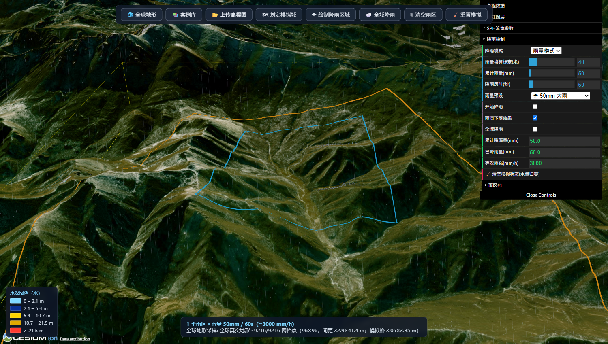
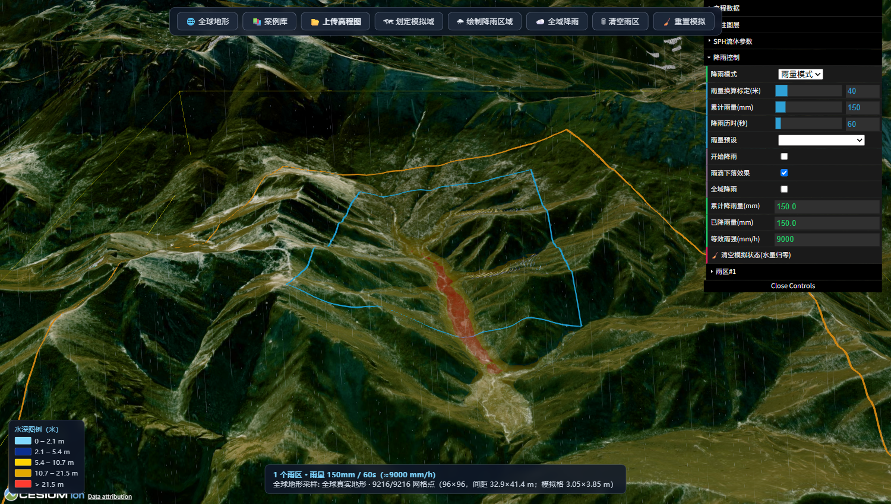

# 案例复演：甘肃渭源双石门沟“7·26”山洪

> 本文用本项目的「高程驱动 + 降雨量注水」流体模型，对 2026 年 7 月 26 日甘肃省定西市渭源县会川镇罗家磨村双石门沟山洪事件做一次**机制性复演**。复演目的不是还原真实灾损，而是验证「上游广域汇水 + 下游狭口束水」这一地形格局在不同雨量下的响应差异，并据此讨论预警与选址问题。

---

## 1. 事件经过

| 项目 | 内容 |
| --- | --- |
| 时间 | 2026 年 7 月 26 日 14 时许（亲历者 13:41 发出“活着真好”消息） |
| 地点 | 甘肃省定西市渭源县会川镇罗家磨村**双石门沟**（双石门景区），会川镇以南约 10 km、距县城约 50 km，海拔约 2400~2800 m，属**露骨山北麓河谷** |
| 灾情 | 7/26 17:40 确认 3 死；18:00 **10 死 23 伤**；8/2 更新为 **25 死 23 伤** |
| 救援 | 转移疏散 247 人、搜救 207 人、成功救出 174 人；救援沿河段约 **3 km**，河面最宽处 **>30 m**；约 **100 m²** 的平缓滩地上堆积 **30 多辆**被冲毁车辆 |
| 督办 | 国家防灾减灾救灾委员会对“7·26”重大山洪灾害**挂牌督办**；甘肃省水利厅 7/26 19 时将定西洪水防御由Ⅳ级提升至Ⅱ级 |

事件本质：**短时强降雨 → 山区沟道暴涨 → 露营区（河漫滩/低阶地）被淹**。伤亡集中在沟口附近的平缓露营地带，多数人是被突发洪水与车辆同时卷走，预警到成灾的时间窗口极短。

## 2. 地形机理：为什么是“漏斗”

中国农业大学孔锋对媒体解释，该沟谷具备三个致命特征：

1. **狭窄深切 V 型谷**：两侧坡面陡、谷底窄，坡面产流几乎没有横向滞蓄空间，雨水几十分钟内就能汇入主沟。
2. **两道巨型石门形成天然卡口**：上游是较开阔的汇水区，下游被石门束窄，形成“**上游广域汇水、下游狭口束水**”的漏斗式格局——流量在上游缓慢汇集、到卡口处迅速抬升水位与流速。
3. **露营地建在河漫滩与阶地低洼处**：这正是历史洪水反复冲刷形成的天然行洪通道，平时是“亲水草坪”，涨水时就是主河道。

这解释了为什么“雨不一定下得特别大”也会成灾：**灾损取决于汇水面积与沟道束窄程度，而不只是降雨强度。**

## 3. 气象与预警：一次“跑在预报前面”的局地强对流

- 7/26 09:06，渭源县气象台发布**雷电黄色预警**（涉及上湾、莲峰、会川等乡镇）。
- 7/26 10:27，定西市应急局发布**强降雨预警**：26 日白天至 27 日有一次降水过程，**过程最大累积 30~50 mm、最大小时雨强 20~30 mm**，主要降水时段为 **26 日 20 时至 27 日 14 时**。
- 实际山洪发生在 **26 日 14 时许**，比预报的主要时段早 6 小时；26 日下午至 27 日凌晨会川镇一带多次出现短时强降雨。
- **官方未公布灾点实测雨量**，只有区域过程雨量预报值。从灾情强度反推，沟口以上小流域在 1~2 小时内很可能出现了**远超 30~50 mm 的局地雨量**（山区对流单体 + 地形抬升）。

这暴露了一个典型问题：**大范围过程预报（30~50 mm）与小流域实际致灾雨量之间存在数量级落差**，而山区短时强降水的落区、时长、强度在现有观测网下很难提前 1~2 小时精确锁定。

## 4. 复演设置

复演使用项目内置的 Cesium 全球真实地形（ArcGIS `Terrain3D`）+ SPH 流体管线，参数如下：

| 项目 | 取值 |
| --- | --- |
| 模拟域（任意多边形） | 约 **3.5 km × 4.4 km**，面积 **10.52 km²**，高程 **2629~3701 m** |
| 域内网格 | 9216/9216 个真实地形采样点 |
| 降雨区（域内上游） | 上游南侧汇水区，面积 **1.46 km²**（约占流域 14%） |
| 降雨方式 | **雨量模式**：50 mm / 60 s（预警量级情景）、150 mm / 60 s（局地强暴雨情景） |
| 时间压缩 | 60 s 墙钟时间代表一场 1~2 小时的降雨过程，等效雨强分别为 3000 / 9000 mm/h（仅表示“同样水量在 60 s 内注完”） |
| 水深换算 | 显示水深 = 水体几何高度（占体积盒比例 × 盒跨度 1073 m，约 50× 放大以便观察）；5 档分界随盒跨度自动取 0.2%/0.5%/1%/2% → 约 2.1 / 5.4 / 10.7 / 21.5 m。真实雨量口径见「已降雨量/累计降雨量」 |
| 边界条件 | 无下渗、无蒸发、无出流；水被限制在模拟域内，域外质量衰减并沿边界反射 |

复演脚本：`test/demo_shuangshimen.mjs`（可传参 `mm` `dur` `tag`），自动完成全球地形定位 → 划域 → 划雨区 → 机位设置 → 注水 → 截面统计（回读 `surfaceTexture`）→ 截图。

## 5. 复演结果

### 5.1 预警量级：50 mm

| 时刻 | 湿面占比 | 平均显示水深 | 最大显示水深 | 5 档分布（浅蓝/深蓝/黄/深黄/红） |
| --- | --- | --- | --- | --- |
| 20 s | 3.1% | 0.3 m | 1.6 m | 100% 浅蓝 |
| 40 s | 4.4% | 2.1 m | 12.3 m | 66.6 / 25.0 / 8.2 / 0.1 / 0 |
| 60 s（注完） | **4.8%** | **3.1 m** | **17.0 m** | 59.8 / 21.7 / 12.1 / 6.4 / 0 |

**表现**：水基本被约束在树枝状沟道网络内（主沟 + 各支沟），坡面上只有极薄的片流；最深处出现在主沟汇口，颜色从浅蓝过渡到黄/深黄，但**没有漫出沟道、没有形成沟口淹没扇**。这对应“下了一场大雨，沟里有水，但营地是安全的”的情景。

### 5.2 局地强暴雨：150 mm

| 时刻 | 湿面占比 | 平均显示水深 | 最大显示水深 | 5 档分布（浅蓝/深蓝/黄/深黄/红） |
| --- | --- | --- | --- | --- |
| 20 s | 7.8% | 1.9 m | 9.9 m | 71.3 / 23.5 / 5.1 / 0 / 0 |
| 40 s | 8.9% | 3.6 m | 24.6 m | 59.5 / 20.8 / 10.6 / 8.8 / 0.3 |
| 60 s（注完） | **9.0%** | **5.5 m** | **31.3 m** | 50.0 / 20.4 / 11.5 / 12.6 / 5.4 |

**表现**：沟道水位抬升后**向两侧坡脚漫溢**，湿面接近 50 mm 情景的 2 倍；主沟汇口以下出现明显的**沟口淹没扇**（图下方喇叭状水面），最深处 31.3 m（显示口径），约为 50 mm 情景的 1.8 倍，且 5 档分布里出现了 5.4% 的红色深水格。此时营地所在的河漫滩与低阶地已整体进水——与实际灾情中“水墙裹挟车辆”的形态一致。

### 5.3 对比结论

| 指标 | 50 mm | 150 mm | 倍数 |
| --- | --- | --- | --- |
| 湿面占比 | 4.8% | 9.0% | 1.9× |
| 最大显示水深 | 17.0 m | 31.3 m | 1.8× |
| 形态 | 沟道线状积水 | 坡面片流 + 沟口淹没扇 | 质变 |

**存在明显的“形态阈值”**：当累计雨量从预警量级（约 50 mm）增加到约 3 倍时，水流从“沟道内汇流”转为“坡面漫流 + 沟口淹没”，这正好对应了露营区从“不受淹”到“被整体淹没”的转变。以本流域 10.52 km²、雨区 1.46 km² 计，50 mm 情景注入约 7.3 万 m³，150 mm 情景约 21.9 万 m³；山区沟道调蓄能力有限，超出部分只能漫滩。

## 6. 结论与启示

1. **致灾主因是地形与选址，不是“极端到无法想象”的雨量。** 漏斗状汇水地形 + 营地占据行洪通道，使 50~150 mm 量级的短时强降雨就足以成灾。选址审查应把“历史洪水痕迹/行洪通道”作为硬约束，而不是按“多少年一遇”的行政标准。
2. **预警口径需要落到小流域。** 30~50 mm 的过程预报对平原城市可能只是大雨，但在 1~2 km² 的陡峭沟道里足以产生山洪。建议把“上游汇水面积、沟道比降、卡口束窄系数”纳入预警分级，而不是只看面雨量。
3. **短临监测是唯一有效的时间窗口。** 事件中从 13:41 的平静到 14 时许的洪峰只有几十分钟，需要雨量站/雷达/视频 AI 的分钟级报警 + 沟口声光报警 + 撤离路线。
4. **模拟可以复现“形态阈值”。** 本次复演显示：50 mm → 沟道内汇流；150 mm → 漫滩淹没。这一阈值对同类型沟谷营地具有参考价值，可作为“撤离触发雨量”的初值（再叠加土壤含水量、前期降雨修正）。

## 7. 局限

- **时间压缩**：为在浏览器内快速观察，60 s 注完一场雨的累计量，等效雨强被放大（3000/9000 mm/h），不代表真实瞬时雨强，也不模拟雨强的时间分布（如 30 分钟雨核）。
- **均匀面雨**：雨区内雨量均一、无空间梯度；真实对流单体往往只有几平方公里核心区，落区偏差会显著改变汇流路径。
- **无下渗/蒸发/出流**：水总量守恒且全部留在地表，长时间会高估积水；对陡峭基岩沟谷，下渗影响较小，但会高估缓坡草地滞蓄。
- **范围有限**：10.52 km² 只覆盖沟口以上近段，真实上游汇水面积更大（可能数十平方公里），因此复演得到的洪峰流量偏保守。
- **地形精度**：使用全球地形瓦片（约 30 m 级）+ 1024² 粒子网格，沟道宽度与卡口形态只能近似表达。
- **不模拟泥沙、漂木、车辆**：真实山洪的破坏力很大程度来自泥沙与漂浮物撞击。

## 8. 资料来源

- 新华社：《甘肃渭源县一景区发生山洪 已致10人遇难》 https://news.cn/20260726/5a974de104e84488aa6934198c25ed66/c.html
- 新华社：《国家防灾减灾救灾委员会对甘肃定西渭源县双石门沟“7·26”重大山洪灾害挂牌督办》 https://www.news.cn/20260802/f7db4f41ffc140e796e73bb82047de48/c.html
- 百度百科：7·26渭源山洪 https://baike.baidu.com/item/7%C2%B726%E6%B8%AD%E6%BA%90%E5%B1%B1%E6%B4%AA/68363729
- 中国农业大学新闻网（孔锋解读）：《山洪突袭露营地，如何防范？》 https://news.cau.edu.cn/mtndnew/6af8064a656e4e08913a22daabbd863b.htm
- 澎湃新闻：《甘肃渭源山洪已致10死23伤，气象部门曾发布强降雨预警》 https://www.thepaper.cn/newsDetail_forward_33663621
- 甘肃省水利厅：《定西洪水防御应急响应由Ⅳ级提升至Ⅱ级》 https://slt.gansu.gov.cn/slt/c106687/c106693/c106701/202607/174372396.shtml
- 香港01：《甘肃渭源双石门景区山洪增至25死23伤》 https://global.hk01.com/即时中国/60375981
- 德国之声：《天灾还是人祸？甘肃双石门景区洪灾已致25人死亡》 https://www.dw.com/zh/天灾还是人祸-甘肃双石门景区洪灾已致25人死亡/a-78207084

> 说明：复演为机制性数值实验，不代表官方调查结论；雨量取值基于公开预警与灾情反推，非实测。